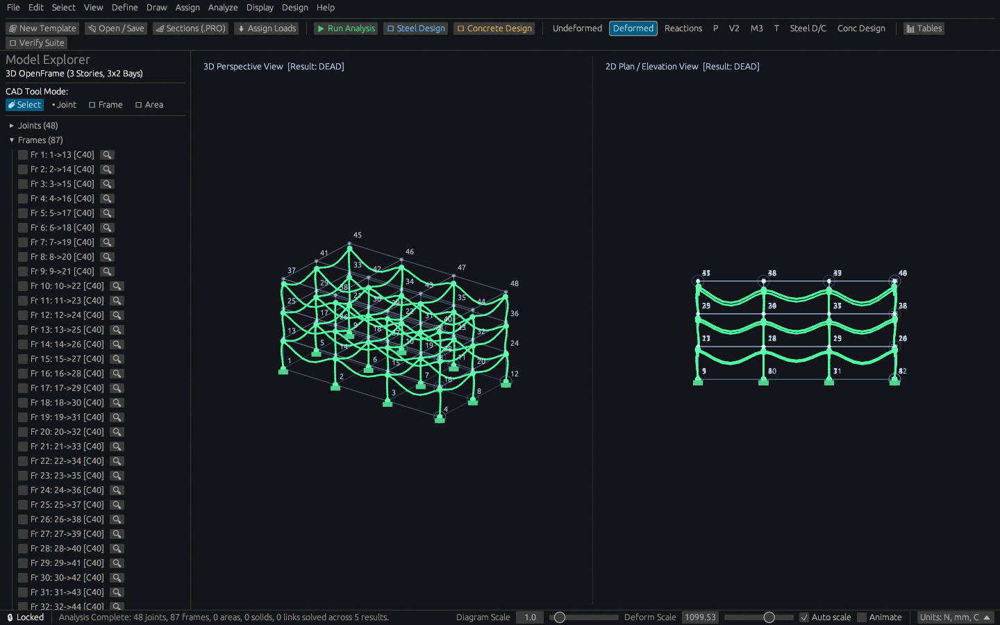
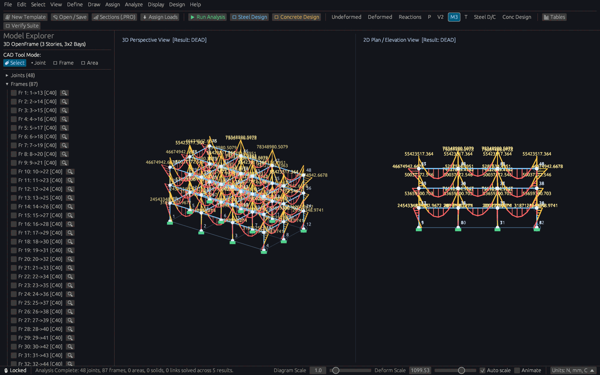
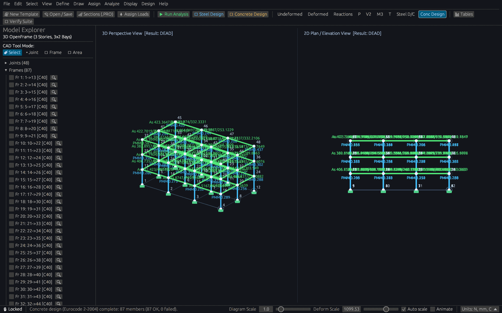

# StructuraX

StructuraX is an experimental native structural-analysis and member-design application written in Rust. It has an egui desktop interface, a command-line interface, and typed Rust APIs. The internal crates retain their `sap-*` names from the reconstruction workspace.

**Development status:** selected analytical checks pass; full SAP2000 compatibility and engineering acceptance have not been established. The `1.0.0` package version is inherited metadata, not a certification or declaration of production readiness. See [review follow-up](docs/review/structurax-followup/REVIEW.md) before relying on the newer solver and export paths.

## Screenshots

The program's own windows, with a generated test model (a three-storey concrete frame), captured on 2026-11-19 on a private display. They show what the windows draw, not a comparison with SAP2000.

| Deformed shape | Moment diagram M3 | Concrete design (Eurocode 2) |
| --- | --- | --- |
|  |  |  |

## Implemented areas

- Frame, area/shell, and solid element analysis, plus selected cable and nonlinear link formulations; frame end offsets, insertion points and automatic subdivision.
- Static, modal (eigenvectors and Ritz vectors), buckling, response-spectrum, modal and direct-integration history cases; P-Delta; nonlinear static cases with user-defined frame hinges, saved states and a pushover curve, for the combinations the capability inventory lists.
- Mass source and ASCE 7-10 automatic seismic loads with entered coefficients.
- Selected AISC 360-10, EC3, ACI 318-14, and EC2 member checks, with Auto Select section lists and default design combinations. A member the design cannot handle is reported with its reason, and the other members are designed.
- Geometry/load/material editing with grid and plane views, case/function definitions, result displays (deformed shapes, shell stresses, contours, plot functions, hinge results), and Rust API access with interactive tables.
- Selected S2K text interchange with source preservation; native SDB inspection, import, exact copying, and experimental export.

These are scoped implementations. Unsupported combinations and known defects are documented in the review and [capability inventory](docs/reconstruction/CAPABILITIES.md). Native export passing this project's parser does not prove that SAP2000 will accept the file. Layered sections, general large-displacement behavior, full design-code coverage, complete history continuation, and broad GUI/API parity must not be inferred from the feature list.

## Recent changes to results

Design results and several analysis results changed on 2026-11-19, after an outside audit of the whole program. [The audit note](docs/reconstruction/audit-2026-11-19.md) lists what moved, what is now refused by name, and what was not verified. Nothing was run in SAP2000: agreement rests on the vendor's manuals and published examples and on hand calculations.

The November 22 repairs cover displacement-controlled P-Delta analysis and member design. Replaying a reported load factor checks equilibrium at the requested displacement. Rectangular concrete beam design now checks shear and torsion extrema together and identifies a failing combination when one exists. Reapplying the interactive load-combination table preserves its type and rejects invalid factors or conflicting definitions.

[The progress ledger](docs/reconstruction/tutorial-video-progress.md) tracks every known defect and missing feature with its status and a timeline of the work. For doubly symmetric steel I-sections with noncompact webs and dimensions consistent with sharp-corner plates, major-axis bending uses the AISC F4 limits. A bending check that needs unrecorded fillet geometry or fabrication data gives a named refusal. With zero major-axis demand, other checks proceed and the result identifies the unavailable capacity (D142). ACI and EC2 beam design requires a rectangular section. Other beam shapes receive a per-member error and the design continues on supported members (D144).

## Build and run

Install a current stable Rust toolchain. On Debian/Ubuntu, the desktop build also needs:

```sh
sudo apt-get install pkg-config libx11-dev libxcb-render0-dev libxcb-shape0-dev libxcb-xfixes0-dev libxkbcommon-dev libgl1-mesa-dev
cargo build --locked --release --bin structurax
./target/release/structurax
```

The Linux desktop uses X11/OpenGL; a Wayland session needs XWayland. Native Windows and macOS packaging scripts exist, but local Linux checks do not establish those platforms' runtime behavior.

```sh
# Selected built-in reference checks
cargo run --locked --bin structurax -- verify

# Analyze a model, optionally including supported member design
cargo run --locked --bin structurax -- analyze model.s2k --design --output results.json

# Inspect a locally supplied section library
cargo run --locked --bin structurax -- inspect-pro /path/to/aisc14.pro W14X90

# Experimental native export of a supported projection; output must not exist
cargo run --locked --bin structurax -- export-native-sdb model.s2k output.sdb
```

Native synthesis accepts supported handwritten S2K tables while retaining the original input. Unknown tables/columns and unrepresented assignments still reject with diagnostics. Native exports through the CLI, API and GUI all require a new destination; written bytes are synchronized and read back before success. Use S2K/private snapshots for supported preservation workflows and native byte-copy for an unchanged original.

## Validation

```sh
cargo test --locked --workspace
cargo clippy --locked --workspace --all-targets -- -D warnings
cargo run --locked --bin structurax -- verify
```

The built-in comparisons are selected synthetic/reference examples, not the complete vendor verification suite. Several legacy tests use locally supplied vendor fixtures and skip when absent. The fourteen newer solver fixture tests (one of them slow and ignored by default) require explicit opt-in: `cargo test -p sap-solver --features vendor-fixtures --test wave4_vendor_regressions`. Set `STRUCTURAX_VENDOR_FIXTURES` to the fixture directory, or use the local `extracted/files/` directory. CI runs without vendor assets. Historical reports under `docs/reconstruction/` describe their own checkpoints and may refer to local-only evidence under `target/`.

## Packages

The GitHub workflow builds development artifacts. It does not publish a production release. Existing local `dist/` packages are excluded from Git.

- **Linux x86_64:** build on Ubuntu 22.04 or an equivalent baseline sysroot, then run `python3 scripts/build_dist_packages.py`. Packaging checks ELF GLIBC requirements and refuses requirements above 2.35. It never rewrites ABI version tags. A successful check is not a substitute for target-distribution GUI testing.
- **Windows x86_64:** run `pwsh -File scripts/package-windows.ps1` on Windows. NSIS is optional for the installer; the ZIP is always produced after a successful build.
- **macOS ARM64:** run `bash scripts/package-macos-arm64.sh` on macOS. Bundles use ad-hoc signing when available; they are not Developer ID signed or notarized.

No installer, vendor binary, vendor manual, vendor model, or vendor `.pro` section database is included in this repository or generated packages. Supply your own permitted section libraries via the application's file selection or `sections/` search path.

## Project and provenance

See [CONTRIBUTING.md](CONTRIBUTING.md) for validation expectations and [ROADMAP.md](ROADMAP.md) for priorities. Reconstruction notes retain the history and limitations of the implementation; they are not a claim of equivalent behavior.

StructuraX is independent of Computers and Structures, Inc. (CSI), and is not affiliated with or endorsed by CSI. SAP2000 is referenced as an interoperability and comparison target. Original project code uses the MIT license; third-party dependencies retain their respective licenses. See [LICENSE](LICENSE).
