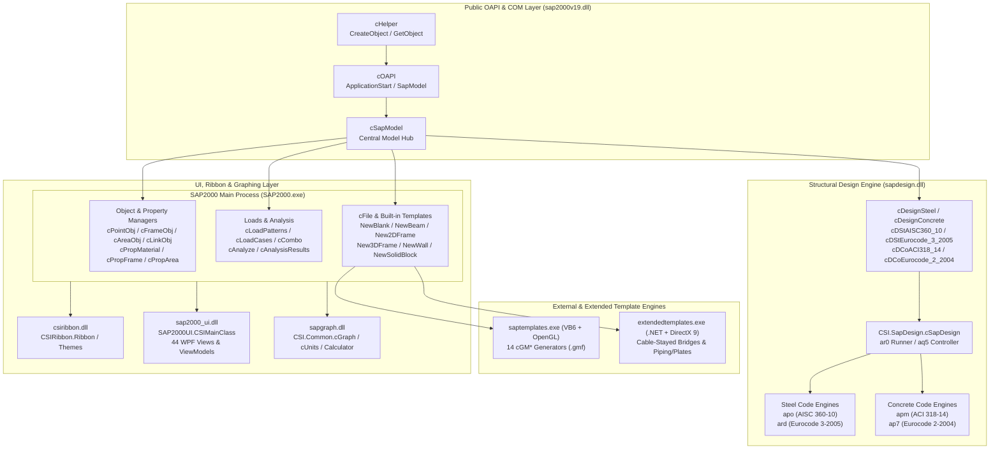

# SAP2000 v19 Reverse Engineering: OAPI, Structural Templates, Design Codes & UI Architecture

This document presents the reverse-engineering analysis of the SAP2000 v19 Open Application Programming Interface (`sap2000v19.dll`), Parametric Structural Template Generators (`saptemplates.exe`, `extendedtemplates.exe`, and `SAP2000.exe`), Structural Design Engine & Verification Suites (`sapdesign.dll`, `sap2000_verification_sfd.xls`, `sap2000_verification_cfd.xls`), and User Interface / Graphing / Ribbon Frameworks (`csiribbon.dll`, `sap2000_ui.dll`, `sapgraph.dll`).

All managed and native binary metadata, symbol tables, method signatures, custom attributes, and embedded string literals were extracted using the REA inspection toolkit (`/home/edo/REA/tools/rea/node_modules/.bin/rea`) and ECMA-335 / PE32 / BIFF8 binary parsers.

---

## 1. Binary Inventory & Architectural Overview

| Binary / Artifact | Format & Architecture | Runtime / Compiler | Primary Namespace / Module | Role in SAP2000 v19 |
| :--- | :--- | :--- | :--- | :--- |
| [`sap2000v19.dll`](file:///home/edo/REA/extracted/files/sap2000v19.dll) | PE32 Managed (`.NET 4.0`, AnyCPU) | CLR v4.0.30319 | `SAP2000v19` | Public COM/OAPI Type Library & Interface Layer (119 types, 1,923 methods, 369 fields). |
| [`saptemplates.exe`](file:///home/edo/REA/extracted/files/saptemplates.exe) | PE32 Native (`x86`, Subsystem GUI) | Visual Basic 6.0 (`MSVBVM60.DLL`) | `SAPTemplates` (v9.0.0.6) | Interactive 2D/3D OpenGL parametric geometry modeler (`cGeomModel`, 14 `cGM*` generators, 19 `frmSTS*` forms). |
| [`extendedtemplates.exe`](file:///home/edo/REA/extracted/files/extendedtemplates.exe) | PE32 Managed (`.NET 4.0`, x86) | CLR v4.0.30319 + DirectX 9 | `CSI.ExtendedTemplates` | Parametric modeler for Cable-Stayed Bridges and Piping/Plate/Tube/Connection meshes (524 types, 3,266 methods). |
| [`sapdesign.dll`](file:///home/edo/REA/extracted/files/sapdesign.dll) | PE32 Managed (`.NET 4.0`, AnyCPU) | CLR v4.0.30319 (Dotfuscator) | `CSI.SapDesign` | Structural Frame Design Engine for Steel, Concrete, Aluminum, Cold-Formed Steel, and API Offshore Checks (410 types, 41,284 methods). |
| [`csiribbon.dll`](file:///home/edo/REA/extracted/files/csiribbon.dll) | PE32 Managed (`.NET 4.0`, AnyCPU) | CLR v4.0.30319 | `CSIRibbon` | Custom WinForms/GDI+/DWM Glass Office-style Ribbon UI control library (122 types, 1,664 methods, 898 fields). |
| [`sap2000_ui.dll`](file:///home/edo/REA/extracted/files/sap2000_ui.dll) | PE32 Managed (`.NET 4.0`, AnyCPU) | CLR v4.0.30319 (Dotfuscator) | `SAP2000UI` | WPF MVVM Dialog, Assignment, Selection, Display & View-Settings UI layer (996 types, 6,416 methods). |
| [`sapgraph.dll`](file:///home/edo/REA/extracted/files/sapgraph.dll) | PE32 Managed (`.NET 4.0`, AnyCPU) | CLR v4.0.30319 (Dotfuscator) | `CSI.Common` / `CSI` | 2D Function Plotting (`cGraph`), Units (`cUnits`), Formula Calculator (`Calculator`), Serialization (`cStream`), and Undo/Redo (`cUndoer`) (275 types, 2,398 methods). |
| [`sap2000_verification_sfd.xls`](file:///home/edo/REA/extracted/files/sap2000_verification_sfd.xls) | OLE2 Compound Document (BIFF8) | Excel 97–2003 Workbook | `Verification Control` | Steel Frame Design verification suite (30 benchmark problems across 12 international design codes). |
| [`sap2000_verification_cfd.xls`](file:///home/edo/REA/extracted/files/sap2000_verification_cfd.xls) | OLE2 Compound Document (BIFF8) | Excel 97–2003 Workbook | `Verification Control` | Concrete Frame Design verification suite (30 benchmark problems across 15 international design codes). |

---

## 2. OAPI (`sap2000v19.dll`) Object Model & Complete Method Reference

### 2.1 OAPI Architecture & Calling Conventions

[`sap2000v19.dll`](file:///home/edo/REA/extracted/files/sap2000v19.dll) exposes the `SAP2000v19` namespace to both .NET clients and COM Automation clients (`ComVisible(true)`, `ClassInterface(ClassInterfaceType.AutoDual)`).

1. **Return Code Convention**: Almost all action/query methods return an `int` (`System.Int32`) status code where **`0` indicates success** and any non-zero value indicates failure or invalid input (formalized in `eReturnCode` for license checks).
2. **Array & Output Parameters**: Output data is returned via `ref` parameters (`ByRef` in COM/VB). Array parameters are 0-based 1D arrays in .NET (`ref string[]`, `ref double[]`, `ref int[]`, `ref bool[]`) sized and populated by the callee, accompanied by a `ref int NumberItems` or `ref int NumberResults` count parameter.
3. **Selection & Group Targeting (`eItemType` / `eItemTypeElm`)**: Assignment and result-query methods accept an optional trailing parameter `eItemType ItemType = eItemType.Objects` (or `eItemTypeElm ItemTypeElm = eItemTypeElm.ObjectElm`), allowing a single API call to operate on a named object (`Objects = 0`), all objects in a group (`Group = 1`), or all currently selected objects (`SelectedObjects = 2`).

---

### 2.2 Enumerations (`SAP2000v19.e*`)

All 20 public enumerations defined in `sap2000v19.dll` and their exact integer constants:

| Enumeration | Values (`Name = Value`) |
| :--- | :--- |
| `eUnits` | `lb_in_F = 1`, `lb_ft_F = 2`, `kip_in_F = 3`, `kip_ft_F = 4`, `kN_mm_C = 5`, `kN_m_C = 6`, `kgf_mm_C = 7`, `kgf_m_C = 8`, `N_mm_C = 9`, `N_m_C = 10`, `Ton_mm_C = 11`, `Ton_m_C = 12`, `kN_cm_C = 13`, `kgf_cm_C = 14`, `N_cm_C = 15`, `Ton_cm_C = 16` |
| `eMatType` | `Steel = 1`, `Concrete = 2`, `NoDesign = 3`, `Aluminum = 4`, `ColdFormed = 5`, `Rebar = 6`, `Tendon = 7` |
| `eFramePropType` | `I = 1`, `Channel = 2`, `T = 3`, `Angle = 4`, `DblAngle = 5`, `Box = 6`, `Pipe = 7`, `Rectangular = 8`, `Circle = 9`, `General = 10`, `DbChannel = 11`, `Auto = 12`, `SD = 13`, `Variable = 14`, `Joist = 15`, `Bridge = 16`, `Cold_C = 17`, `Cold_2C = 18`, `Cold_Z = 19`, `Cold_L = 20`, `Cold_2L = 21`, `Cold_Hat = 22`, `BuiltUpICoverplate = 23`, `PCCGirderI = 24`, `PCCGirderU = 25`, `BuiltUpIHybrid = 26`, `BuiltUpUHybrid = 27`, `Concrete_L = 28`, `Cold_Box = 29`, `Cold_I = 30`, `Cold_Pipe = 31`, `Cold_T = 32`, `Trapezoidal = 33`, `PCCGirderSuperT = 34` |
| `eAreaPropType` | `Shell = 1`, `Plane = 2`, `ASolid = 3` |
| `eShellType` | `ShellThin = 1`, `ShellThick = 2`, `PlateThin = 3`, `PlateThick = 4`, `Membrane = 5`, `ShellLayered = 6` |
| `eWallPropType` | `Specified = 1`, `AutoSelectList = 2` |
| `eSlabType` | `Slab = 0`, `Drop = 1`, `Stiff = 2`, `Ribbed = 3`, `Waffle = 4`, `Mat = 5`, `Footing = 6` |
| `eDeckType` | `Filled = 1`, `Unfilled = 2`, `SolidSlab = 3` |
| `eLinkPropType` | `Linear = 1`, `Damper = 2`, `Gap = 3`, `Hook = 4`, `PlasticWen = 5`, `RubberIsolator = 6`, `FrictionIsolator = 7`, `MultiLinearElastic = 8`, `MultiLinearPlastic = 9`, `TCFrictionIsolator = 10`, `DamperBilinear = 11`, `DamperFrictionSpring = 12`, `TriplePendulumIsolator = 13` |
| `eLoadPatternType` | `Dead = 1`, `SuperDead = 2`, `Live = 3`, `ReduceLive = 4`, `Quake = 5`, `Wind = 6`, `Snow = 7`, `Other = 8`, `Move = 9`, `Temperature = 10`, `Rooflive = 11`, `Notional = 12`, `PatternLive = 13`, `Wave = 14`, `Braking = 15`, `Centrifugal = 16`, `Friction = 17`, `Ice = 18`, `WindOnLive = 19`, `HorizontalEarthPressure = 20`, `VerticalEarthPressure = 21`, `EarthSurcharge = 22`, `DownDrag = 23`, `VehicleCollision = 24`, `VesselCollision = 25`, `TemperatureGradient = 26`, `Settlement = 27`, `Shrinkage = 28`, `Creep = 29`, `WaterloadPressure = 30`, `LiveLoadSurcharge = 31`, `LockedInForces = 32`, `PedestrianLL = 33`, `Prestress = 34`, `Hyperstatic = 35`, `Bouyancy = 36`, `StreamFlow = 37`, `Impact = 38`, `Construction = 39`, `DeadWearing = 40`, `DeadWater = 41`, `DeadManufacture = 42`, `EarthHydrostatic = 43`, `PassiveEarthPressure = 44`, `ActiveEarthPressure = 45`, `PedestrianLLReduced = 46` |
| `eLoadCaseType` | `LinearStatic = 1`, `NonlinearStatic = 2`, `Modal = 3`, `ResponseSpectrum = 4`, `LinearHistory = 5`, `NonlinearHistory = 6`, `LinearDynamic = 7`, `NonlinearDynamic = 8`, `MovingLoad = 9`, `Buckling = 10`, `SteadyState = 11`, `PowerSpectralDensity = 12`, `LinearStaticMultiStep = 13`, `HyperStatic = 14`, `ExternalResults = 15` |
| `eItemType` | `Objects = 0`, `Group = 1`, `SelectedObjects = 2` |
| `eItemTypeElm` | `ObjectElm = 0`, `Element = 1`, `GroupElm = 2`, `SelectionElm = 3` |
| `eCNameType` | `LoadCase = 0`, `LoadCombo = 1` |
| `e2DFrameType` | `PortalFrame = 0`, `ConcentricBraced = 1`, `EccentricBraced = 2` |
| `e3DFrameType` | `OpenFrame = 0`, `PerimeterFrame = 1`, `BeamSlab = 2`, `FlatPlate = 3` |
| `eConstraintType` | `Body = 1`, `Diaphragm = 2`, `Plate = 3`, `Rod = 4`, `Beam = 5`, `Equal = 6`, `Local = 7`, `Weld = 8`, `Line = 9` |
| `eConstraintAxis` | `X = 1`, `Y = 2`, `Z = 3`, `AutoAxis = 4` |
| `eHingeLocationType` | `RelativeDistance = 1`, `OffsetFromIEnd = 2`, `OffsetFromJEnd = 3` |
| `eReturnCode` | `NoError = 0`, `UnspecifiedError = -10`, `EnvVarNotFound = -20`, `EnvVarValueInvalid = -30`, `LicenseNotFound = -40`, `LicenseCheckOutFailed = -50` |

---

### 2.3 Root & Model Management Interfaces (`cHelper`, `cOAPI`, `cSapModel`, `cFile`)

#### `cHelper` (`SAP2000v19.cHelper` / Class `SAP2000v19.Helper`)
Factory interface used to instantiate or attach to a running `SAP2000.exe` process:
- `cOAPI CreateObject(string fullPathToExe)`
- `cOAPI CreateObjectProgID(string progID)` — typically `"CSI.SAP2000.API.SapObject"`
- `cOAPI GetObject(string progID = "CSI.SAP2000.API.SapObject")`
- `cOAPI GetObjectProcess(string progID, int processID = 0)`

#### `cOAPI` (`SAP2000v19.cOAPI` / Class `SAP2000v19.SapObject`)
Top-level application controller:
- `int ApplicationStart(eUnits Units = eUnits.kip_in_F, bool Visible = true, string FileName = "")`
- `int ApplicationExit(bool FileSave)`
- `double GetOAPIVersionNumber()`
- `int Hide()` / `int Unhide()` / `bool Visible()`
- `int SetAsActiveObject()` / `int UnsetAsActiveObject()`
- `cSapModel SapModel { get; }`

#### `cSapModel` (`SAP2000v19.cSapModel`)
Central model object exposing 45 subsystem interfaces and 43 model-level methods:
- **Subsystem Properties**:
  - Object Managers: `PointObj` (`cPointObj`), `FrameObj` (`cFrameObj`), `CableObj` (`cCableObj`), `TendonObj` (`cTendonObj`), `AreaObj` (`cAreaObj`), `SolidObj` (`cSolidObj`), `LinkObj` (`cLinkObj`)
  - Element Managers: `PointElm` (`cPointElm`), `LineElm` (`cLineElm`), `AreaElm` (`cAreaElm`), `SolidElm` (`cSolidElm`), `LinkElm` (`cLinkElm`)
  - Property Definitions: `PropMaterial` (`cPropMaterial`), `PropFrame` (`cPropFrame`), `PropCable` (`cPropCable`), `PropTendon` (`cPropTendon`), `PropArea` (`cPropArea`), `PropSolid` (`cPropSolid`), `PropLink` (`cPropLink`)
  - Loads, Analysis & Results: `LoadPatterns` (`cLoadPatterns`), `LoadCases` (`cLoadCases`), `RespCombo` (`cCombo`), `Analyze` (`cAnalyze`), `Results` (`cAnalysisResults`), `Func` (`cFunction`)
  - Design Subsystems: `DesignSteel` (`cDesignSteel`), `DesignConcrete` (`cDesignConcrete`), `DesignAluminum` (`cDesignAluminum`), `DesignColdFormed` (`cDesignColdFormed`)
  - Editing, View & Utilities: `File` (`cFile`), `SelectObj` (`cSelect`), `View` (`cView`), `GroupDef` (`cGroup`), `ConstraintDef` (`cConstraint`), `CoordSys` (`cCoordSys`), `GridSys` (`cGridSys`), `JointPattern` (`cPattern`), `NamedAssign` (`cNamedAssign`), `Options` (`cOptions`), `EditGeneral` (`cEditGeneral`), `EditPoint` (`cEditPoint`), `EditFrame` (`cEditFrame`), `EditArea` (`cEditArea`), `EditSolid` (`cEditSolid`)
- **Model-Level Methods**:
  - `int InitializeNewModel(eUnits Units = eUnits.kip_in_F)`
  - `eUnits GetPresentUnits()` / `int SetPresentUnits(eUnits Units)`
  - `eUnits GetDatabaseUnits()`
  - `string GetPresentCoordSystem()` / `int SetPresentCoordSystem(string CSys)`
  - `bool GetModelIsLocked()` / `int SetModelIsLocked(bool LockIt)`
  - `string GetModelFilename(bool IncludePath = true)` / `string GetModelFilepath()`
  - `int GetVersion(ref string Version, ref double MyVersionNumber)`
  - `int GetMergeTol(ref double MergeTol)` / `int SetMergeTol(double MergeTol)`
  - `int GetProjectInfo(ref int NumberItems, ref string[] ProjectInfoItem, ref string[] ProjectInfoData)`
  - `int SetProjectInfo(string ProjectInfoItem, string ProjectInfoData)`
  - `int GetUserComment(ref string CommentUser)` / `int SetUserComment(string CommentUser, int NumLines = 1, bool Replace = false)`

#### `cFile` (`SAP2000v19.cFile`)
File I/O and built-in OAPI parametric model generators:
- `int OpenFile(string FileName)` — supports `.sdb`, `.s2k`, `.$2k`, `.xls`, `.mdb`
- `int Save(string FileName = "")`
- `int NewBlank()`
- `int NewBeam(int NumberSpans, double SpanLength, bool Restraint = true, string Beam = "Default", bool NumberLines = false, double[] Spacing = null, bool LocateOrigin = false)`
- `int New2DFrame(e2DFrameType TempType, int NumberStories, double StoryHeight, int NumberBays, double BayWidth, bool Restraint = true, string Beam = "Default", string Column = "Default", string Brace = "Default", double Eccentricity = 0.0, bool NumberLines = false, double[] SpacingX = null, double[] SpacingZ = null, bool LocateOrigin = false)`
- `int New3DFrame(e3DFrameType TempType, int NumberStories, double StoryHeight, int NumBaysX, double BayWidthX, int NumBaysY, double BayWidthY, bool Restraint = true, string Beam = "Default", string Column = "Default", string Area = "Default", int NumberXDivs = 4, int NumberYDivs = 4, bool NumberLines = false, double[] SpacingX = null, double[] SpacingY = null, double[] SpacingZ = null, bool LocateOrigin = false)`
- `int NewWall(int NumberXDivs, double DivisionWidthX, int NumberZDivs, double DivisionWidthZ, bool Restraint = true, string Area = "Default", bool NumberLines = false, double[] SpacingX = null, double[] SpacingZ = null, bool LocateOrigin = false)`
- `int NewSolidBlock(double XWidth, double YWidth, double Height, bool Restraint = true, string Solid = "Default", int NumberXDivs = 5, int NumberYDivs = 8, int NumberZDivs = 10)`

---

### 2.4 Object Managers (`cPointObj`, `cFrameObj`, `cAreaObj`, `cLinkObj`)

#### `cPointObj` (`SAP2000v19.cPointObj` — 59 Methods)
Manages point (joint) objects, restraints, springs, masses, Diaphragm/Body constraints, panel zones, and nodal loads:
- **Creation & Geometry**:
  - `int AddCartesian(double x, double y, double z, ref string Name, string UserName = "", string CSys = "Global", bool MergeOff = false, int MergeNumber = 0)`
  - `int AddCylindrical(double r, double Theta, double z, ref string Name, string UserName = "", string CSys = "Global", bool MergeOff = false, int MergeNumber = 0)`
  - `int AddSpherical(double r, double a, double b, ref string Name, string UserName = "", string CSys = "Global", bool MergeOff = false, int MergeNumber = 0)`
  - `int GetCoordCartesian(string Name, ref double x, ref double y, ref double z, string CSys = "Global")`
  - `int GetCoordCylindrical(string Name, ref double r, ref double Theta, ref double z, string CSys = "Global")`
  - `int GetCoordSpherical(string Name, ref double r, ref double a, ref double b, string CSys = "Global")`
  - `int ChangeName(string Name, string NewName)` / `int Count()` / `int GetNameList(ref int NumberNames, ref string[] MyName)`
  - `int GetConnectivity(string Name, ref int NumberItems, ref int[] ObjectType, ref string[] ObjectName, ref int[] PointNumber)`
  - `int GetElm(string Name, ref string Elm)` / `int GetTransformationMatrix(string Name, ref double[] Value, bool IsGlobal = true)`
- **Restraints, Constraints & Springs**:
  - `int SetRestraint(string Name, ref bool[] Value, eItemType ItemType = eItemType.Objects)` (`Value[0..5]` = `U1, U2, U3, R1, R2, R3`)
  - `int GetRestraint(string Name, ref bool[] Value)` / `int DeleteRestraint(string Name, eItemType ItemType = eItemType.Objects)` / `int CountRestraint()`
  - `int SetConstraint(string Name, ref string ConstraintName, eItemType ItemType = eItemType.Objects, bool Replace = true)`
  - `int GetConstraint(string Name, ref int NumberItems, ref string[] PointName, ref string[] ConstraintName, eItemType ItemType = eItemType.Objects)` / `int DeleteConstraint(string Name, eItemType ItemType = eItemType.Objects)` / `int CountConstraint(string Name = "")`
  - `int SetSpring(string Name, ref double[] k, eItemType ItemType = eItemType.Objects, bool IsLocalCSys = false, bool Replace = false)` (`k[0..5]` = `U1, U2, U3, R1, R2, R3`)
  - `int SetSpringCoupled(string Name, ref double[] k, eItemType ItemType = eItemType.Objects, bool IsLocalCSys = false, bool Replace = false)` (`k[0..20]` = 21 upper-triangular terms of coupled $6 \times 6$ stiffness matrix)
  - `int GetSpring(string Name, ref double[] k)` / `int GetSpringCoupled(string Name, ref double[] k)` / `int IsSpringCoupled(string Name, ref bool IsCoupled)` / `int DeleteSpring(string Name, eItemType ItemType = eItemType.Objects)` / `int CountSpring()`
- **Masses, Local Axes, Panel Zones & Special Point Settings**:
  - `int SetMass(string Name, ref double[] m, eItemType ItemType = eItemType.Objects, bool IsLocalCSys = false, bool Replace = false)`
  - `int SetMassByWeight(string Name, ref double[] w, eItemType ItemType = eItemType.Objects, bool IsLocalCSys = false, bool Replace = false)`
  - `int SetMassByVolume(string Name, ref double[] v, string MatProp, eItemType ItemType = eItemType.Objects, bool IsLocalCSys = false, bool Replace = false)`
  - `int GetMass(string Name, ref double[] m)` / `int DeleteMass(string Name, eItemType ItemType = eItemType.Objects)`
  - `int SetLocalAxes(string Name, double a, double b, double c, eItemType ItemType = eItemType.Objects)` / `int GetLocalAxes(string Name, ref double a, ref double b, ref double c, ref bool Advanced)`
  - `int SetLocalAxesAdvanced(string Name, bool Active, int AxVectOpt, string AxCSys, ref int[] AxDir, ref string[] AxPt, ref double[] AxVect, int Plane2, int PlVectOpt, string PlCSys, ref int[] PlDir, ref string[] PlPt, ref double[] PlVect, eItemType ItemType = eItemType.Objects)`
  - `int SetPanelZone(string Name, int PropType, double Thickness, double k1, double k2, string LinkProp, int Connectivity, int LocalAxisFrom, double LocalAxisAngle, eItemType ItemType = eItemType.Objects)` / `int GetPanelZone(...)` / `int DeletePanelZone(...)`
  - `int SetSpecialPoint(string Name, bool SpecialPoint, eItemType ItemType = eItemType.Objects)` / `int GetSpecialPoint(string Name, ref bool SpecialPoint)` / `int DeleteSpecialPoint(string Name, eItemType ItemType = eItemType.Objects)`
  - `int SetMergeNumber(string Name, bool MergeOff, int MergeNumber, eItemType ItemType = eItemType.Objects)` / `int GetMergeNumber(string Name, ref bool MergeOff, ref int MergeNumber)`
- **Nodal Loads, Displacements & Patterns**:
  - `int SetLoadForce(string Name, string LoadPat, ref double[] Value, bool Replace = false, string CSys = "Global", eItemType ItemType = eItemType.Objects)` (`Value[0..5]` = `F1, F2, F3, M1, M2, M3`)
  - `int GetLoadForce(string Name, ref int NumberItems, ref string[] PointName, ref string[] LoadPat, ref int[] LCStep, ref string[] CSys, ref double[] F1, ref double[] F2, ref double[] F3, ref double[] M1, ref double[] M2, ref double[] M3, eItemType ItemType = eItemType.Objects)`
  - `int DeleteLoadForce(string Name, string LoadPat, eItemType ItemType = eItemType.Objects)` / `int CountLoadForce(string Name = "", string LoadPat = "")`
  - `int SetLoadDispl(string Name, string LoadPat, ref double[] Value, bool Replace = false, string CSys = "Global", eItemType ItemType = eItemType.Objects)`
  - `int GetLoadDispl(string Name, ref int NumberItems, ref string[] PointName, ref string[] LoadPat, ref int[] LCStep, ref string[] CSys, ref double[] U1, ref double[] U2, ref double[] U3, ref double[] R1, ref double[] R2, ref double[] R3, eItemType ItemType = eItemType.Objects)`
  - `int DeleteLoadDispl(string Name, string LoadPat, eItemType ItemType = eItemType.Objects)` / `int CountLoadDispl(string Name = "", string LoadPat = "")`
  - `int SetPatternByXYZ(string Name, string PatternName, double a, double b, double c, double d, eItemType ItemType = eItemType.Objects, int Restriction = 0, bool Replace = false)`
  - `int SetPatternByPressure(string Name, string PatternName, double ZCoordZeroPressure, double WeightPerUnitVolume, double UniformForcePerUnitArea, int Restriction, bool Replace = false, eItemType ItemType = eItemType.Objects)`
  - `int GetPatternValue(string Name, string PatternName, ref double Value)` / `int DeletePatternValue(string Name, string PatternName, eItemType ItemType = eItemType.Objects)`
  - `int SetGroupAssign(string Name, string GroupName, bool Remove = false, eItemType ItemType = eItemType.Objects)`
  - `int SetSelected(string Name, bool Selected, eItemType ItemType = eItemType.Objects)` / `int GetSelected(string Name, ref bool Selected)`
  - `int GetGUID(string Name, ref string GUID)` / `int SetGUID(string Name, string GUID = "")`

#### `cFrameObj` (`SAP2000v19.cFrameObj` — 104 Methods)
Manages 2-node straight and curved frame elements, section assignments, end releases, end offsets, cardinal insertion points, nonlinear hinges, auto-meshing, and frame loads:
- **Creation & Geometry**:
  - `int AddByCoord(double xi, double yi, double zi, double xj, double yj, double zj, ref string Name, string PropName = "Default", string UserName = "", string CSys = "Global")`
  - `int AddByPoint(string Point1, string Point2, ref string Name, string PropName = "Default", string UserName = "")`
  - `int AddCurvedByCoord(int FrameType, double xi, double yi, double zi, double xj, double yj, double zj, ref string Name, double gx, double gy, double gz, string Point3Name, double Radius, int NumSegs, string PropName = "Default", string UserName = "", string CSys = "Global")`
  - `int AddCurvedByPoint(int FrameType, string Point1, string Point2, ref string Name, double gx, double gy, double gz, string Point3Name, double Radius, int NumSegs, string PropName = "Default", string UserName = "")`
  - `int GetPoints(string Name, ref string Point1, ref string Point2)` / `int GetElm(string Name, ref int NumberElms, ref string[] Elm, ref double[] RDI, ref double[] RDJ)`
  - `int GetCurved_2(string Name, ref int FrameType, ref double gx, ref double gy, ref double gz, ref string PointName, ref double Radius, ref int NumSegs, ref string NonCirCurve)`
  - `int ChangeName(string Name, string NewName)` / `int Delete(string Name, eItemType ItemType = eItemType.Objects)` / `int Count()` / `int GetNameList(ref int NumberNames, ref string[] MyName)`
- **Section, Modifiers, Releases, Insertion Point & Offsets**:
  - `int SetSection(string Name, string PropName, eItemType ItemType = eItemType.Objects, double sVarRelStartLoc = 0.0, double sVarTotalLength = 0.0)`
  - `int GetSection(string Name, ref string PropName, ref string SAuto)` / `int GetSectionNonPrismatic(string Name, ref string PropName, ref double sVarRelStartLoc, ref double sVarTotalLength)`
  - `int SetModifiers(string Name, ref double[] Value, eItemType ItemType = eItemType.Objects)` / `int GetModifiers(string Name, ref double[] Value)` / `int DeleteModifiers(string Name, eItemType ItemType = eItemType.Objects)` (`Value[0..7]` = `Area, As2, As3, Torsion, I22, I33, Mass, Weight`)
  - `int SetReleases(string Name, ref bool[] ii, ref bool[] jj, ref double[] StartValue, ref double[] EndValue, eItemType ItemType = eItemType.Objects)` / `int GetReleases(...)` / `int DeleteReleases(...)` (`ii[0..5], jj[0..5]` = `U1, U2, U3, R1, R2, R3` end releases and partial-fixity springs)
  - `int SetInsertionPoint(string Name, int CardinalPoint, bool Mirror2, bool StiffTransform, ref double[] Offset1, ref double[] Offset2, string CSys = "Local", eItemType ItemType = eItemType.Objects)` / `int GetInsertionPoint(...)`
  - `int SetEndLengthOffset(string Name, bool AutoOffset, double Length1, double Length2, double RZ, eItemType ItemType = eItemType.Objects)` / `int GetEndLengthOffset(...)`
  - `int SetEndSkew(string Name, int SkewOption, double SkewI, double SkewJ, eItemType ItemType = eItemType.Objects)` / `int GetEndSkew(...)`
  - `int SetLocalAxes(string Name, double Ang, eItemType ItemType = eItemType.Objects)` / `int GetLocalAxes(string Name, ref double Ang, ref bool Advanced)` / `int SetLocalAxesAdvanced(...)`
  - `int SetOutputStations(string Name, int OutputStationType, double MaxSegSize, int MinSections, bool NoOutPutAndDesignAtElementEnds, bool NoOutPutAndDesignAtPointLoads, eItemType ItemType = eItemType.Objects)` / `int GetOutputStations(...)`
  - `int SetAutoMesh(string Name, bool AutoMesh, bool AutoMeshAtPoints, bool AutoMeshAtLines, int NumSegs, doubleAutoMeshMaxLength, eItemType ItemType = eItemType.Objects)` / `int GetAutoMesh(...)`
  - `int SetTCLimits(string Name, bool LimitCompressionExists, double LimitCompression, bool LimitTensionExists, double LimitTension, eItemType ItemType = eItemType.Objects)` / `int GetTCLimits(...)`
  - `int SetPDeltaForce(string Name, int Count, ref double[] PDeltaForce, ref int[] Dir, ref string[] CSys, bool Replace = true, eItemType ItemType = eItemType.Objects)`
  - `int SetSpring(string Name, int MyType, double s, int SimpleSpringType, string LinkProp, int SpringLocalOneType, int Dir, bool Outward, ref double[] Vec, double Ang, bool Replace = false, string CSys = "Local", eItemType ItemType = eItemType.Objects)`
  - `int SetMass(string Name, double MassOverL, bool Replace = false, eItemType ItemType = eItemType.Objects)`
  - `int SetMaterialOverwrite(string Name, string PropName, eItemType ItemType = eItemType.Objects)` / `int SetMaterialTemp(string Name, double Temp, string PatternName, eItemType ItemType = eItemType.Objects)`
  - `int SetDesignProcedure(string Name, int MyType, eItemType ItemType = eItemType.Objects)` / `int GetDesignProcedure(string Name, ref int MyType)` (`1=Steel, 2=Concrete, 3=Aluminum, 4=ColdFormed, 7=NoDesign, 8=DefaultFromMaterial`)
  - `int GetHingeAssigns(string Name, ref int NumberHinges, ref int[] HingeNum, ref string[] PropName, ref int[] MyType, ref int[] Behavior, ref string[] Source, ref double[] RD, ref eHingeLocationType[] LocationType, ref double[] Offset)`
  - `int SetFireProofing_1(...)` / `int GetFireProofing_1(...)` / `int DeleteFireProofing(...)`
- **Frame Loads**:
  - `int SetLoadDistributed(string Name, string LoadPat, int MyType, int Dir, double Dist1, double Dist2, double Val1, double Val2, string CSys = "Global", bool RelDist = true, bool Replace = true, eItemType ItemType = eItemType.Objects)` (`MyType`: `1=Force`, `2=Moment`; `Dir`: `1..3=Local 1..3`, `4..6=CSys X..Z`, `7..9=Projected X..Z`, `10=Gravity`, `11=Projected Gravity`)
  - `int GetLoadDistributed(string Name, ref int NumberItems, ref string[] FrameName, ref string[] LoadPat, ref int[] MyType, ref string[] CSys, ref int[] Dir, ref double[] RD1, ref double[] RD2, ref double[] Dist1, ref double[] Dist2, ref double[] Val1, ref double[] Val2, eItemType ItemType = eItemType.Objects)`
  - `int DeleteLoadDistributed(string Name, string LoadPat, eItemType ItemType = eItemType.Objects)`
  - `int SetLoadPoint(string Name, string LoadPat, int MyType, int Dir, double Dist, double Val, string CSys = "Global", bool RelDist = true, bool Replace = true, eItemType ItemType = eItemType.Objects)`
  - `int GetLoadPoint(string Name, ref int NumberItems, ref string[] FrameName, ref string[] LoadPat, ref int[] MyType, ref string[] CSys, ref int[] Dir, ref double[] RelDist, ref double[] Dist, ref double[] Val, eItemType ItemType = eItemType.Objects)`
  - `int DeleteLoadPoint(string Name, string LoadPat, eItemType ItemType = eItemType.Objects)`
  - `int SetLoadTemperature(string Name, string LoadPat, int MyType, double Val, string PatternName = "", bool Replace = true, eItemType ItemType = eItemType.Objects)`
  - `int SetLoadStrain(...)` / `int SetLoadDeformation(...)` / `int SetLoadTargetForce(...)` / `int SetLoadGravity(...)`

#### `cAreaObj` (`SAP2000v19.cAreaObj` — 61 Methods)
Manages 3-node (triangle) and 4-node (quadrilateral) shell/plane/axisymmetric area objects:
- **Creation & Geometry**:
  - `int AddByCoord(int NumberPoints, ref double[] x, ref double[] y, ref double[] z, ref string Name, string PropName = "Default", string UserName = "", string CSys = "Global")`
  - `int AddByPoint(int NumberPoints, ref string[] Point, ref string Name, string PropName = "Default", string UserName = "")`
  - `int GetPoints(string Name, ref int NumberPoints, ref string[] Point)` / `int GetElm(string Name, ref int NumberElms, ref string[] Elm)`
  - `int ChangeName(string Name, string NewName)` / `int Delete(string Name, eItemType ItemType = eItemType.Objects)` / `int Count()` / `int GetNameList(ref int NumberNames, ref string[] MyName)`
- **Properties, Modifiers, Meshing & Edge Constraints**:
  - `int SetProperty(string Name, string PropName, eItemType ItemType = eItemType.Objects)` / `int GetProperty(string Name, ref string PropName)`
  - `int SetModifiers(string Name, ref double[] Value, eItemType ItemType = eItemType.Objects)` / `int GetModifiers(string Name, ref double[] Value)` (`Value[0..9]` = `f11, f22, f12, m11, m22, m12, v13, v23, Mass, Weight`)
  - `int SetThickness(string Name, int ThicknessType, string ThicknessPattern, double ThicknessPatternSF, ref double[] Thickness, eItemType ItemType = eItemType.Objects)`
  - `int SetOffsets(string Name, int OffsetType, string OffsetPattern, double OffsetPatternSF, ref double[] Offset, eItemType ItemType = eItemType.Objects)`
  - `int SetAutoMesh(string Name, int MeshType, int n1 = 2, int n2 = 2, double MaxSize1 = 0.0, double MaxSize2 = 0.0, bool PointOnEdgeFromLine = false, bool PointOnEdgeFromPoint = false, bool ExtendCookieCutLines = false, double Rotation = 0.0, double MaxSizeGeneral = 0.0, bool LocalAxesOnEdge = false, bool LocalAxesOnFace = false, bool RestraintsOnEdge = false, bool RestraintsOnFace = false, string Group = "ALL", bool SubMesh = false, double SubMeshSize = 0.0, eItemType ItemType = eItemType.Objects)`
  - `int SetEdgeConstraint(string Name, bool ConstraintExists, eItemType ItemType = eItemType.Objects)` / `int GetEdgeConstraint(string Name, ref bool ConstraintExists)`
  - `int SetLocalAxes(string Name, double Ang, eItemType ItemType = eItemType.Objects)` / `int SetSpring(...)` / `int SetMass(...)`
- **Area Loads**:
  - `int SetLoadUniform(string Name, string LoadPat, double Value, int Dir, bool Replace = true, string CSys = "Global", eItemType ItemType = eItemType.Objects)`
  - `int SetLoadUniformToFrame(string Name, string LoadPat, double Value, int Dir, int DistType, bool Replace = true, string CSys = "Global", eItemType ItemType = eItemType.Objects)` (`DistType`: `1=One-Way`, `2=Two-Way`)
  - `int SetLoadSurfacePressure(string Name, string LoadPat, int Face, double Value, string PatternName = "", bool Replace = true, eItemType ItemType = eItemType.Objects)`
  - `int SetLoadPorePressure(...)` / `int SetLoadTemperature(...)` / `int SetLoadStrain(...)` / `int SetLoadRotate(...)` / `int SetLoadWindPressure(...)` / `int SetLoadGravity(...)`

#### `cLinkObj` (`SAP2000v19.cLinkObj` — 44 Methods)
Manages 1-joint (grounded) and 2-joint linear/nonlinear link and isolator elements:
- `int AddByCoord(double xi, double yi, double zi, double xj, double yj, double zj, ref string Name, bool IsSingleJoint = false, string PropName = "Default", string UserName = "", string CSys = "Global")`
- `int AddByPoint(string Point1, string Point2, ref string Name, bool IsSingleJoint = false, string PropName = "Default", string UserName = "")`
- `int SetProperty(string Name, string PropName, eItemType ItemType = eItemType.Objects)` / `int GetProperty(string Name, ref string PropName)`
- `int SetPropertyFD(string Name, string PropName, eItemType ItemType = eItemType.Objects)` / `int GetPropertyFD(string Name, ref string PropName)` (Frequency-Dependent link properties)
- `int SetModifiers(string Name, ref double[] Value, eItemType ItemType = eItemType.Objects)` / `int GetModifiers(string Name, ref double[] Value)`
- `int SetLocalAxes(string Name, double Ang, eItemType ItemType = eItemType.Objects)` / `int SetLocalAxesAdvanced(...)`
- `int SetLoadGravity(...)` / `int SetLoadDeformation(...)` / `int SetLoadTargetForce(...)`

---

### 2.5 Property Definitions (`cPropMaterial`, `cPropFrame`, `cPropArea`)

#### `cPropMaterial` (`SAP2000v19.cPropMaterial` — 56 Methods)
Defines isotropic, orthotropic, uniaxial, and nonlinear stress-strain materials:
- `int SetMaterial(string Name, eMatType MatType, int Color = -1, string Notes = "", string GUID = "")`
- `int AddQuick(ref string Name, eMatType MatType, int SymType = 0, int Grade = 0, string UserName = "")`
- `int SetWeightAndMass(string Name, int MyOption, double Value, double Temp = 0.0)` (`MyOption`: `1=WeightPerUnitVolume`, `2=MassPerUnitVolume`)
- `int SetMPIsotropic(string Name, double e, double u, double a, double g = 0.0, double Temp = 0.0)` ($E$, $\nu$, $\alpha$, $G$)
- `int SetMPOrthotropic(string Name, ref double[] e, ref double[] u, ref double[] a, ref double[] g, double Temp = 0.0)`
- `int SetMPAnisotropic(string Name, ref double[] e, ref double[] u, ref double[] a, ref double[] g, double Temp = 0.0)`
- `int SetMPUniaxial(string Name, double e, double a, double Temp = 0.0)`
- **Type-Specific Design Material Parameters**:
  - `int SetOSteel_1(string Name, double Fy, double Fu, double eFy, double eFu, int SSType, int SSHysType, double StrainAtHardening, double StrainAtMaxStress, double StrainAtRupture, double FinalSlope, double Temp = 0.0)`
  - `int SetOConcrete_1(string Name, double fc, bool IsLightweight, double fcsfactor, int SSType, int SSHysType, double StrainAtfc, double StrainUltimate, double FinalSlope, double FrictionAngle = 0.0, double DilatationalAngle = 0.0, double Temp = 0.0)`
  - `int SetORebar_1(string Name, double Fy, double Fu, double eFy, double eFu, int SSType, int SSHysType, double StrainAtHardening, double StrainUltimate, double FinalSlope, bool UseCaltransSSDefaults = false, double Temp = 0.0)`
  - `int SetOAluminum_1(string Name, int AlumType, string Alloy, double Fcy, double Fty, double Ftu, double Fsu, int SSHysType, double Temp = 0.0)`
  - `int SetOColdFormed(string Name, double Fy, double Fu, int SSHysType, double Temp = 0.0)`
  - `int SetOTendon_1(string Name, double Fy, double Fu, int SSType, int SSHysType, double FinalSlope, double Temp = 0.0)`
  - `int SetSSCurve(string Name, int PointID, int MyOption, int NumberPoints, ref double[] Strain, ref double[] Stress, double Temp = 0.0)`
  - `int SetDamping(string Name, double ModalDampingRatio, double ViscousMassCoeff, double ViscousStiffCoeff, double HystereticMassCoeff, double HystereticStiffCoeff, double Temp = 0.0)`
  - `cMatPropTimeDep TimeDep { get; }` (CEB-FIP 90, CEB-FIP 2010, ACI 209R-92, JTG D62-2004, Eurocode 2-2004 creep/shrinkage)

#### `cPropFrame` (`SAP2000v19.cPropFrame` — 81 Methods)
Defines frame cross-sections, reinforcement, section property modifiers, and database imports:
- **Standard Parametric Cross-Sections**:
  - `int SetISection(string Name, string MatProp, double t3, double t2, double tf, double tw, double t2b, double tfb, int Color = -1, string Notes = "", string GUID = "")`
  - `int SetRectangle(string Name, string MatProp, double t3, double t2, int Color = -1, string Notes = "", string GUID = "")`
  - `int SetCircle(string Name, string MatProp, double t3, int Color = -1, string Notes = "", string GUID = "")`
  - `int SetPipe(string Name, string MatProp, double t3, double tw, int Color = -1, string Notes = "", string GUID = "")`
  - `int SetTube(string Name, string MatProp, double t3, double t2, double tf, double tw, int Color = -1, string Notes = "", string GUID = "")`
  - `int SetChannel(string Name, string MatProp, double t3, double t2, double tf, double tw, int Color = -1, string Notes = "", string GUID = "")`
  - `int SetTee(string Name, string MatProp, double t3, double t2, double tf, double tw, int Color = -1, string Notes = "", string GUID = "")`
  - `int SetAngle(string Name, string MatProp, double t3, double t2, double tf, double tw, int Color = -1, string Notes = "", string GUID = "")`
  - `int SetDblAngle(...)` / `int SetDbChannel(...)` / `int SetConcreteTee(...)` / `int SetConcreteL(...)` / `int SetConcreteBox(...)` / `int SetConcretePipe(...)` / `int SetConcreteCross(...)` / `int SetTrapezoidal(...)`
  - `int SetColdC(...)` / `int SetCold2C(...)` / `int SetColdZ(...)` / `int SetColdL(...)` / `int SetCold2L(...)` / `int SetColdHat(...)` / `int SetColdBox(...)` / `int SetColdI(...)` / `int SetColdPipe(...)` / `int SetColdT(...)`
  - `int SetCoverPlatedI(...)` / `int SetHybridISection(...)` / `int SetHybridUSection(...)` / `int SetPrecastI(...)` / `int SetPrecastU(...)` / `int SetPrecastSuperT(...)`
  - `int SetGeneral(string Name, string MatProp, double t3, double t2, double Area, double As2, double As3, double Torsion, double I22, double I33, double S22, double S33, double Z22, double Z33, double R22, double R33, int Color = -1, string Notes = "", string GUID = "")`
  - `int SetNonPrismatic(string Name, int NumberItems, ref string[] StartSec, ref string[] EndSec, ref double[] MyLength, ref int[] MyType, ref int[] EI33, ref int[] EI22, int Color = -1, string Notes = "", string GUID = "")`
  - `int SetAutoSelectSteel(string Name, int NumberItems, ref string[] AutoSectionName, string StartingSection = "Median")`
  - `int SetSDProp(string Name, string MatProp, int DesignType, int Color = -1, string Notes = "", string GUID = "")` (`PropSDShape` sub-interface for Section Designer shapes)
- **Concrete Section Reinforcement & Section Queries**:
  - `int SetRebarColumn(string Name, string MatPropLong, string MatPropConfine, int Pattern, int ConfineType, double Cover, int NumberCBars, int NumberR3Bars, int NumberR2Bars, string RebarSize, string TieSize, double TieSpacingLongit, int Number2DirTieBars, int Number3DirTieBars, bool ToBeDesigned)`
  - `int SetRebarBeam(string Name, string MatPropLong, string MatPropConfine, double CoverTop, double CoverBot, double TopLeftArea, double TopRightArea, double BotLeftArea, double BotRightArea)`
  - `int ImportProp(string Name, string MatProp, string FileName, string ShapeName, int Color = -1, string Notes = "", string GUID = "")` (imports from `.pro` section property libraries such as `AISC14.pro`, `EURO.pro`, `CISC.pro`)
  - `int GetSectProps(string Name, ref double Area, ref double As2, ref double As3, ref double Torsion, ref double I22, ref double I33, ref double S22, ref double S33, ref double Z22, ref double Z33, ref double R22, ref double R33)`
  - `int SetModifiers(string Name, ref double[] Value)` / `int GetModifiers(string Name, ref double[] Value)`

#### `cPropArea` (`SAP2000v19.cPropArea` — 24 Methods)
Defines shell, plane, and axisymmetric solid section properties:
- `int SetShell_1(string Name, int ShellType, bool IncludeDrillingDOF, string MatProp, double MatAngle, double Thickness, double Bending, int Color = -1, string Notes = "", string GUID = "")` (`ShellType`: `1=ShellThin`, `2=ShellThick`, `3=PlateThin`, `4=PlateThick`, `5=Membrane`, `6=ShellLayered`)
- `int SetShellDesign(string Name, string MatProp, int SteelLayoutOption, double DesignCoverTopDir1, double DesignCoverTopDir2, double DesignCoverBotDir1, double DesignCoverBotDir2)`
- `int SetShellLayer_2(string Name, int NumLayers, ref string[] LayerName, ref double[] Dist, ref double[] Thickness, ref int[] MyType, ref int[] NumIntegrationPts, ref string[] MatProp, ref double[] MatAngle, ref int[] MatBehavior, ref int[] S11Type, ref int[] S22Type, ref int[] S12Type)`
- `int SetPlane(string Name, int MyType, string MatProp, double MatAngle, double Thickness, bool IncompatibleModes, int Color = -1, string Notes = "", string GUID = "")`
- `int SetASolid(string Name, string MatProp, double MatAngle, double Arc, bool IncompatibleModes, string CSys = "Global", int Color = -1, string Notes = "", string GUID = "")`
- `int SetModifiers(string Name, ref double[] Value)` / `int GetModifiers(string Name, ref double[] Value)`

---

### 2.6 Loads, Load Cases & Response Combinations (`cLoadPatterns`, `cLoadCases`, `cCombo`)

#### `cLoadPatterns` (`SAP2000v19.cLoadPatterns` — 15 Methods)
- `int Add(string Name, eLoadPatternType MyType, double SelfWTMultiplier = 0.0, bool AddLoadCase = true)`
- `int GetLoadType(string Name, ref eLoadPatternType MyType)` / `int SetLoadType(string Name, eLoadPatternType MyType)`
- `int GetSelfWTMultiplier(string Name, ref double SelfWTMultiplier)` / `int SetSelfWTMultiplier(string Name, double SelfWTMultiplier)`
- `int ChangeName(string Name, string NewName)` / `int Delete(string Name)` / `int Count()` / `int GetNameList(ref int NumberNames, ref string[] MyName)`
- `cAutoSeismic AutoSeismic { get; }` (36 methods: `SetASCE710`, `SetASCE705`, `SetEurocode82004_1`, `SetIBC2012`, `SetIBC2009`, `SetIBC2006`, `SetNBCC2015`, `SetNBCC2010`, `SetChinese2010`, `SetIS1893_2002`, `SetItalianNTC2008`, `SetNZS11702004`, `SetTS2007`, `SetUserLoad`, `SetUserCoefficient`, `SetNone`)
- `cAutoWind AutoWind { get; }` (34 methods: `SetASCE710`, `SetASCE705`, `SetASCE702`, `SetEurocode12005_1`, `SetNBCC2015`, `SetNBCC2010`, `SetChinese2010`, `SetIS8751987`, `SetItalianNTC2008`, `SetMexican`, `SetAPI4F2013`, `SetBS639995`, `SetASNZS117022002`, `SetUser`, `SetNone`)

#### `cLoadCases` (`SAP2000v19.cLoadCases` — 11 Methods + 16 Sub-Interfaces)
- **Top-Level Methods**:
  - `int GetNameList(ref int NumberNames, ref string[] MyName, eLoadCaseType CaseType = (eLoadCaseType)0)`
  - `int GetTypeOAPI_1(string Name, ref eLoadCaseType CaseType, ref int SubType, ref int DesignType, ref int DesignTypeOption, ref int Auto)`
  - `int SetDesignType(string Name, int DesignTypeOption, eLoadPatternType DesignType = eLoadPatternType.Dead)`
  - `int ChangeName(string Name, string NewName)` / `int Delete(string Name)` / `int Count(eLoadCaseType CaseType = (eLoadCaseType)0)`
- **16 Load Case Sub-Interfaces**:
  - `StaticLinear` (`cCaseStaticLinear`): `SetCase(string Name)`, `SetLoads(string Name, int NumberLoads, ref string[] LoadType, ref string[] LoadName, ref double[] SF)`, `SetInitialCase(string Name, string InitialCase)`
  - `StaticNonlinear` (`cCaseStaticNonlinear`): `SetCase`, `SetLoads`, `SetGeometricNonlinearity(string Name, int NLGeomType)` (`0=None, 1=PDelta, 2=LargeDispl`), `SetHingeUnloading(string Name, int UnloadType)`, `SetLoadApplication(string Name, int LoadControl, int DispType, double Displ, int Monitor, int DOF, string PointName, string GDispl)`, `SetModalCase`, `SetMassSource`, `SetResultsSaved`, `SetSolControlParameters`, `SetTargetForceParameters`
  - `StaticNonlinearStaged` (`cCaseStaticNonlinearStaged`): `SetCase`, `SetStageDefinitions_2`, `SetStageData_2`, `SetMaterialNonlinearity`, `SetGeometricNonlinearity`, `SetResultsSaved`, `SetSolControlParameters`
  - `ModalEigen` (`cCaseModalEigen`): `SetCase`, `SetNumberModes(string Name, int MaxModes, int MinModes)`, `SetParameters(string Name, double EigenShiftFreq, double EigenCutOff, double EigenTol, int AllowAutoFreqShift)`, `SetLoads`, `SetInitialCase`
  - `ModalRitz` (`cCaseModalRitz`): `SetCase`, `SetNumberModes`, `SetLoads(string Name, int NumberLoads, ref string[] LoadType, ref string[] LoadName, ref int[] MaxCycles, ref double[] TargetPar)`
  - `ResponseSpectrum` (`cCaseResponseSpectrum`): `SetCase`, `SetLoads(string Name, int NumberLoads, ref string[] LoadName, ref string[] Func, ref double[] SF, ref string[] CSys, ref double[] Ang)`, `SetModalCase`, `SetModalComb_1(string Name, int MyType, double f1, double f2, int PeriodicRigidCombType, double td)` (`1=CQC, 2=SRSS, 3=ABS, 4=GMC, 5=10Pct, 6=DoubleSum`), `SetDirComb(string Name, int MyType, double SF)` (`1=SRSS, 2=ABS, 3=CQC3`), `SetDampingConstant`, `SetDampingInterpolated`, `SetDampingOverrides`, `SetDampingProportional`, `SetEccentricity`
  - `ModalHistoryLinear` (`cCaseModalHistoryLinear`), `ModalHistoryNonlinear` (`cCaseModalHistoryNonlinear`), `DirectHistoryLinear` (`cCaseDirectHistoryLinear`), `DirectHistoryNonlinear` (`cCaseDirectHistoryNonlinear`), `Buckling` (`cCaseBuckling`), `HyperStatic` (`cCaseHyperStatic`), `MovingLoad` (`cCaseMovingLoad`), `PSD` (`cCasePSD`), `SteadyState` (`cCaseSteadyState`), `ExternalResults` (`cCaseExternalResults`)

#### `cCombo` (`SAP2000v19.cCombo` — `cSapModel.RespCombo` — 18 Methods)
- `int Add(string Name, int ComboType)` (`0 = Linear Additive`, `1 = Envelope`, `2 = Absolute Additive`, `3 = SRSS`, `4 = Range Additive`)
- `int AddDesignDefaultCombos(bool DesignSteel, bool DesignConcrete, bool DesignAluminum, bool DesignColdFormed)`
- `int SetCaseList_1(string Name, ref eCNameType CNameType, string CName, int ModeNumber, double SF)`
- `int GetCaseList_1(string Name, ref int NumberItems, ref eCNameType[] CNameType, ref string[] CName, ref int[] ModeNumber, ref double[] SF)`
- `int DeleteCase(string Name, eCNameType CNameType, string CName)`
- `int GetTypeCombo(string Name, ref int ComboType)`
- `int SetNote(string Name, string Note)` / `int GetNote(string Name, ref string Note)`
- `int ChangeName(string Name, string NewName)` / `int Delete(string Name)` / `int Count()` / `int CountCase(string Name)` / `int GetNameList(ref int NumberNames, ref string[] MyName)`

---

### 2.7 Analysis Execution & Results (`cAnalyze`, `cAnalysisResults`, `cAnalysisResultsSetup`)

#### `cAnalyze` (`SAP2000v19.cAnalyze` — 19 Methods)
- `int RunAnalysis()`
- `int CreateAnalysisModel()`
- `int SetRunCaseFlag(string Name, bool Run, bool All = false)` / `int GetRunCaseFlag(ref int NumberItems, ref string[] CaseName, ref bool[] Run)`
- `int GetCaseStatus(ref int NumberItems, ref string[] CaseName, ref int[] Status)` (`1=NotRun, 2=CouldNotStart, 3=NotFinished, 4=Finished`)
- `int GetActiveDOF(ref bool[] DOF)` / `int SetActiveDOF(ref bool[] DOF)` (`DOF[0..5]` = `UX, UY, UZ, RX, RY, RZ`)
- `int GetSolverOption_1(ref int SolverType, ref int SolverProcessType, ref bool Force32BitSolver, ref string StiffCase)` (`SolverType`: `0=Standard, 1=Advanced, 2=MultiThreaded`; `SolverProcessType`: `0=Auto, 1=GUIProcess, 2=SeparateProcess`)
- `int SetSolverOption_1(int SolverType, int SolverProcessType, bool Force32BitSolver, string StiffCase = "")`
- `int DeleteResults(string Name, bool All = false)`
- `int ModifyUndeformedGeometry(string CaseName, double SF, int Stage = -1, bool Original = false)`
- `int ModifyUndeformedGeometryModeShape(string CaseName, int Mode, double MaxDisp, int Direction, bool Original = false)`
- `int MergeAnalysisResults(string FileName)`

#### `cAnalysisResultsSetup` (`cSapModel.Results.Setup` — 26 Methods)
Configures which load cases/combinations and output options are active prior to calling `cAnalysisResults`:
- `int DeselectAllCasesAndCombosForOutput()`
- `int SetCaseSelectedForOutput(string Name, bool Selected = true)` / `int GetCaseSelectedForOutput(string Name, ref bool Selected)`
- `int SetComboSelectedForOutput(string Name, bool Selected = true)` / `int GetComboSelectedForOutput(string Name, ref bool Selected)`
- `int SetOptionMultiStepStatic(int Value)` / `int SetOptionNLStatic(int Value)` / `int SetOptionModalHist(int Value)` / `int SetOptionDirectHist(int Value)` (`1=Envelopes, 2=StepByStep, 3=LastStep`)
- `int SetOptionMultiValuedCombo(int Value)` (`1=Envelopes, 2=MultipleValues, 3=Correspondence`)
- `int SetOptionBucklingMode(int BuckModeStart, int BuckModeEnd, bool BuckModeAll = false)`
- `int SetOptionModeShape(int ModeShapeStart, int ModeShapeEnd, bool ModeShapeAll = false)`
- `int SetOptionBaseReactLoc(double gx, double gy, double gz)` / `int SetOptionSectionCut(int Value)` / `int SetOptionPSD(int Value)` / `int SetOptionSteadyState(int Value, int SteadyStateOption)`

#### `cAnalysisResults` (`cSapModel.Results` — 32 Methods)
Extracts elemental, nodal, modal, and global response quantities:
- **Joint & Global Responses**:
  - `int JointDispl(string Name, eItemTypeElm ItemTypeElm, ref int NumberResults, ref string[] Obj, ref string[] Elm, ref string[] LoadCase, ref string[] StepType, ref double[] StepNum, ref double[] U1, ref double[] U2, ref double[] U3, ref double[] R1, ref double[] R2, ref double[] R3)`
  - `int JointDisplAbs(...)` / `int JointVel(...)` / `int JointVelAbs(...)` / `int JointAcc(...)` / `int JointAccAbs(...)`
  - `int JointReact(string Name, eItemTypeElm ItemTypeElm, ref int NumberResults, ref string[] Obj, ref string[] Elm, ref string[] LoadCase, ref string[] StepType, ref double[] StepNum, ref double[] F1, ref double[] F2, ref double[] F3, ref double[] M1, ref double[] M2, ref double[] M3)`
  - `int BaseReact(ref int NumberResults, ref string[] LoadCase, ref string[] StepType, ref double[] StepNum, ref double[] FX, ref double[] FY, ref double[] FZ, ref double[] MX, ref double[] MY, ref double[] MZ, ref double[] gx, ref double[] gy, ref double[] gz)`
  - `int BaseReactWithCentroid(...)` / `int GeneralizedDispl(...)`
- **Frame, Cable, Link, Area & Solid Responses**:
  - `int FrameForce(string Name, eItemTypeElm ItemTypeElm, ref int NumberResults, ref string[] Obj, ref double[] ObjSta, ref string[] Elm, ref double[] ElmSta, ref string[] LoadCase, ref string[] StepType, ref double[] StepNum, ref double[] P, ref double[] V2, ref double[] V3, ref double[] T, ref double[] M2, ref double[] M3)`
  - `int FrameJointForce(string Name, eItemTypeElm ItemTypeElm, ref int NumberResults, ref string[] Obj, ref string[] Elm, ref string[] PointElm, ref string[] LoadCase, ref string[] StepType, ref double[] StepNum, ref double[] F1, ref double[] F2, ref double[] F3, ref double[] M1, ref double[] M2, ref double[] M3)`
  - `int AreaForceShell(string Name, eItemTypeElm ItemTypeElm, ref int NumberResults, ref string[] Obj, ref string[] Elm, ref string[] PointElm, ref string[] LoadCase, ref string[] StepType, ref double[] StepNum, ref double[] F11, ref double[] F22, ref double[] F12, ref double[] FMax, ref double[] FMin, ref double[] FAngle, ref double[] FVM, ref double[] M11, ref double[] M22, ref double[] M12, ref double[] MMax, ref double[] MMin, ref double[] MAngle, ref double[] V13, ref double[] V23, ref double[] VMax, ref double[] VAngle)`
  - `int AreaStressShell(...)` / `int AreaStressShellLayered(...)` / `int AreaJointForceShell(...)` / `int AreaStrainShell(...)` / `int AreaStrainShellLayered(...)`
  - `int AreaStressPlane(...)` / `int AreaJointForcePlane(...)` / `int AreaStrainPlane(...)`
  - `int AreaStressASolid(...)` / `int AreaJointForceASolid(...)` / `int AreaStrainASolid(...)`
  - `int SolidStress(...)` / `int SolidJointForce(...)` / `int SolidStrain(...)`
  - `int LinkForce(...)` / `int LinkJointForce(...)` / `int LinkDeformation(...)`
  - `int SectionCutAnalysis(...)` / `int SectionCutDesign(...)`
- **Modal & Buckling Responses**:
  - `int ModalPeriod(ref int NumberResults, ref string[] LoadCase, ref string[] StepType, ref double[] StepNum, ref double[] Period, ref double[] Frequency, ref double[] CircFreq, ref double[] EigenValue)`
  - `int ModalParticipationFactors(...)` / `int ModalParticipatingMassRatios(...)` / `int ModalLoadParticipationRatios(...)`
  - `int ModeShape(string Name, eItemTypeElm ItemTypeElm, ref int NumberResults, ref string[] Obj, ref string[] Elm, ref string[] LoadCase, ref string[] StepType, ref double[] StepNum, ref double[] U1, ref double[] U2, ref double[] U3, ref double[] R1, ref double[] R2, ref double[] R3)`
  - `int BucklingFactor(ref int NumberResults, ref string[] LoadCase, ref string[] StepType, ref double[] StepNum, ref double[] Factor)`
  - `int AssembledJointMass_1(...)` / `int StepLabel(...)`

---

### 2.8 Steel & Concrete Design Interfaces (`cDesignSteel`, `cDesignConcrete`)

#### `cDesignSteel` (`cSapModel.DesignSteel` — 24 Methods + 19 Code Sub-Interfaces)
- **Core Methods**:
  - `int StartDesign()`
  - `int DeleteResults()`
  - `int GetCode(ref string CodeName)` / `int SetCode(string CodeName)`
  - `int GetSummaryResults(string Name, ref int NumberItems, ref string[] FrameName, ref double[] Ratio, ref int[] RatioType, ref double[] Location, ref string[] ComboName, ref string[] ErrorSummary, ref string[] WarningSummary, eItemType ItemType = eItemType.Objects)` (`RatioType`: `1=PMM, 2=MajorShear, 3=MinorShear, 4=MajorBeamDeflection, 5=MinorBeamDeflection`)
  - `int VerifyPassed(ref int NumberItems, ref int NumberNotPassed, ref int NumberNotChecked, ref string[] MyName)`
  - `int VerifySections(ref int NumberItems, ref string[] MyName)`
  - `int SetDesignSection(string Name, string PropName, bool LastAnalysis, eItemType ItemType = eItemType.Objects)` / `int GetDesignSection(string Name, ref string PropName)`
  - `int SetAutoSelectNull(string Name, eItemType ItemType = eItemType.Objects)`
  - `int ResetOverwrites()`
  - `int GetComboStrength(ref int NumberItems, ref string[] MyName)` / `int SetComboStrength(string Name, bool Selected)`
  - `int GetComboDeflection(ref int NumberItems, ref string[] MyName)` / `int SetComboDeflection(string Name, bool Selected)`
  - `int GetComboAutoGenerate(ref bool AutoGenerate)` / `int SetComboAutoGenerate(bool AutoGenerate)`
  - `int GetGroup(ref int NumberItems, ref string[] MyName)` / `int SetGroup(string Name, bool Selected)`
  - `int GetTargetDispl(ref int NumberItems, ref string[] LoadCase, ref string[] Point, ref double[] Displ, ref bool[] Active)` / `int SetTargetDispl(int NumberItems, ref string[] LoadCase, ref string[] Point, ref double[] Displ, bool Active = true)`
  - `int GetTargetPeriod(ref int NumberItems, ref string ModalCase, ref int[] Mode, ref double[] Period, ref bool[] Active)` / `int SetTargetPeriod(int NumberItems, string ModalCase, ref int[] Mode, ref double[] Period, bool Active = true)`
- **Code-Specific Sub-Interfaces on `cDesignSteel`** (each exposes `GetPreference(int Item, ref double Value)`, `SetPreference(int Item, double Value)`, `GetOverwrite(string Name, int Item, ref double Value, ref bool ProgDet)`, `SetOverwrite(string Name, int Item, double Value, eItemType ItemType = eItemType.Objects)`):
  - `AISC360_10` (`cDStAISC360_10`), `AISC360_05_IBC2006` (`cDStAISC360_05_IBC2006`), `AISC_ASD89` (`cDStAISC_ASD89`), `AISC_LRFD93` (`cDStAISC_LRFD93`), `Eurocode_3_2005` (`cDStEurocode_3_2005`), `ItalianNTC2008` (`cDStItalianNTC2008`), `AS4100_1998` (`cDStAS4100_1998`), `BS5950_2000` (`cDStBS5950_2000`), `CAN_CSA_S16_01` (`cDStCAN_CSA_S16_01`), `CSA_S16_09` (`cDStCSA_S16_09`), `CSA_S16_14` (`cDStCSA_S16_14`), `Chinese_2010` (`cDStChinese_2010`), `Indian_IS_800_1998` (`cDStIndian_IS_800_1998`), `Indian_IS_800_2007` (`cDStIndian_IS_800_2007`), `KBC_2009` (`cDStKBC_2009`), `NZS3404_1997` (`cDStNZS3404_1997`), `Norsok_N_004` (`cDStNorsok_N_004`), `Norsok_N_004_2013` (`cDStNorsok_N_004_2013`), `SP16_13330_2011` (`cDStSP16_13330_2011`)

#### `cDesignConcrete` (`cSapModel.DesignConcrete` — 21 Methods + 16 Code Sub-Interfaces)
- **Core Methods**:
  - `int StartDesign()`
  - `int DeleteResults()`
  - `int GetCode(ref string CodeName)` / `int SetCode(string CodeName)`
  - `int GetSummaryResultsBeam(string Name, ref int NumberItems, ref string[] FrameName, ref double[] Location, ref string[] TopCombo, ref double[] TopArea, ref string[] BotCombo, ref double[] BotArea, ref string[] VmajorCombo, ref double[] VmajorArea, ref string[] TLCombo, ref double[] TLArea, ref string[] TTCombo, ref double[] TTArea, ref string[] ErrorSummary, ref string[] WarningSummary, eItemType ItemType = eItemType.Objects)`
  - `int GetSummaryResultsColumn(string Name, ref int NumberItems, ref string[] FrameName, ref int[] MyOption, ref double[] Location, ref string[] PMMCombo, ref double[] PMMArea, ref double[] PMMRatio, ref string[] VmajorCombo, ref double[] AVmajor, ref string[] VminorCombo, ref double[] AVminor, ref string[] ErrorSummary, ref string[] WarningSummary, eItemType ItemType = eItemType.Objects)` (`MyOption`: `1=Check, 2=Design`)
  - `int GetSummaryResultsJoint(string Name, ref int NumberItems, ref string[] FrameName, ref string[] LCJSRatioMajor, ref double[] JSRatioMajor, ref string[] LCJSRatioMinor, ref double[] JSRatioMinor, ref string[] LCBCCRatioMajor, ref double[] BCCRatioMajor, ref string[] LCBCCRatioMinor, ref double[] BCCRatioMinor, ref string[] ErrorSummary, ref string[] WarningSummary, eItemType ItemType = eItemType.Objects)`
  - `int VerifyPassed(ref int NumberItems, ref int NumberNotPassed, ref int NumberNotChecked, ref string[] MyName)`
  - `int VerifySections(ref int NumberItems, ref string[] MyName)`
  - `int SetDesignSection(string Name, string PropName, bool LastAnalysis, eItemType ItemType = eItemType.Objects)` / `int GetDesignSection(string Name, ref string PropName)`
  - `int ResetOverwrites()`
  - `int GetComboStrength(ref int NumberItems, ref string[] MyName)` / `int SetComboStrength(string Name, bool Selected)`
  - `int GetComboAutoGenerate(ref bool AutoGenerate)` / `int SetComboAutoGenerate(bool AutoGenerate)`
- **Code-Specific Sub-Interfaces on `cDesignConcrete`**:
  - `ACI318_14` (`cDCoACI318_14`), `ACI318_11` (`cDCoACI318_11`), `ACI318_08_IBC2009` (`cDCoACI318_08_IBC2009`), `Eurocode_2_2004` (`cDCoEurocode_2_2004`), `ItalianNTC2008` (`cDCoItalianNTC2008`), `AS3600_2009` (`cDCoAS3600_2009`), `AASHTO_Concrete_2007` (`cDCoAASHTO_Concrete_2007`), `BS8110_97` (`cDCoBS8110_97`), `CSA_A233_04` (`cDCoCSA_A233_04`), `CSA_A233_14` (`cDCoCSA_A233_14`), `Chinese_2010` (`cDCoChinese_2010`), `Hong_Kong_CP_2013` (`cDCoHong_Kong_CP_2013`), `Indian_IS_456_2000` (`cDCoIndian_IS_456_2000`), `KBC_2009` (`cDCoKBC_2009`), `Mexican_RCDF_2004` (`cDCoMexican_RCDF_2004`), `NZS_3101_2006` (`cDCoNZS_3101_2006`), `SP63_13330_2012` (`cDCoSP63_13330_2012`), `Singapore_CP_65_99` (`cDCoSingapore_CP_65_99`), `TS_500_2000` (`cDCoTS_500_2000`)

---

## 3. Structural Templates (`SAP2000.exe`, `saptemplates.exe`, `extendedtemplates.exe`)

SAP2000 v19 implements a **three-tier parametric template system**:
1. **Tier 1 — Built-in `SAP2000.exe` Forms (`TemplateCtrlForm`, `TemplateDataForm`, `TemplateParametricDefinitionForm`, `TemplateUndergroundConcreteForm`, `BridgeTemplateForm`) & OAPI `cFile`**: Generates standard beams, 2D/3D trusses, 2D/3D frames, shear walls, flat slabs, thin/thick shells, staircases, storage tanks/silos, underground concrete box culverts, solid arches/blocks, and suspension bridges directly in-process.
2. **Tier 2 — `saptemplates.exe` (VB6 Native + OpenGL Modeler)**: Standalone/COM parametric generator (`cGeomModel` + 14 `cGM*` classes) with interactive 2D/3D OpenGL previews, cross-section shape editors, 2D curve editors, and `.gmf` geometric model export.
3. **Tier 3 — `extendedtemplates.exe` (`CSI.ExtendedTemplates` .NET 4.0 + DirectX 9 Modeler)**: Advanced parametric modeler for **Cable-Stayed Bridges** (`fCableStayedMain2Towers`, `cCableStayedBridgeTwoTowrs`) and **Plates, Pipes, Tubes, Connections & Transitions** (`fPipingMain`, `fObjectEditor`, `fLocateComponent`).

---

### 3.1 Built-in `SAP2000.exe` Templates (`TemplateCtrlForm` & `TemplateDataForm`)

When the user invokes **File > New Model** (`msNewModel` / `tsNewModel`), `TemplateCtrlForm` displays the template selection grid alongside:
- **Initialize Model from**: Default (`Initialize New Model with Default Definitions`) or existing `.sdb` file (`Initialize New Model with Definitions and Preferences from an Existing File`)
- **Units (`cboUnits`)**: `eUnits` (`lb, in, F` .. `Ton, cm, C`)
- **Project Information**: `Modify/Show Project Information...`

| Template Category | Sub-Types (`cboType` / Radio Options) | Parametric Inputs (`TemplateDataForm` / `TemplateParametricDefinitionForm` / OAPI) | Section / Restraint / Grid Options |
| :--- | :--- | :--- | :--- |
| **Blank** | `NewBlank` | None (creates empty coordinate system). | Base units (`eUnits`). |
| **Grid Only** | `Cartesian`, `Cylindrical` | **Cartesian**: `Number of Grid Lines` (`X`, `Y`, `Z`), `Grid Spacing` (`X`, `Y`, `Z`), `First Grid Line Location` (`X1`, `Y1`, `Z1`). **Cylindrical**: `Along Radius`, `Along Theta`, `Along Z` counts, spacings, and `R1, T1, Z1`. | `Edit Grid...` (`GeneralGridsForm`: custom grid spacing). |
| **Beam** | `cFile.NewBeam` | `Number of Spans`, `Span Length`. | `Restraints` checkbox, `Beam` section (`cboSection_0`), `Custom Grid Spacing`, `Locate Origin`. |
| **2D Trusses** | `Sloped Truss`, `Vertical Truss`, `Pratt Truss` | **Sloped / Vertical Truss**: `Number of Divisions`, `Height`, `Division Length` (`N`, `H`, `L`). **Pratt Truss**: `Span Length, L1`, `Num. of Divisions, N1`, `Span Length, L2`, `Num. of Divisions, N2`, `Height, H1`, `Height, H2`, `Height, H3`. | `Restraints`, `Chords` section, `Braces` section, `Gridlines`. |
| **3D Trusses** | `Roof Truss`, `Transmission Tower 1..4`, `Guyed Tower` | **Roof Truss**: `Number of Bays, X`, `Number of Bays, Y`, `Span Length, X`, `Number of Divisions, X`, `Span Length, Y`, `Number of Divisions, Y`, `Height`. **Transmission Towers 1–4**: Base/waist/top widths `B1..B6`, segment heights `H1..H9`, vertical panel divisions `N1..N6`, cross-arm spans `S1`, `A1`, `W1`. **Guyed Tower**: Mast height, panel count, guy anchor radii & elevations, initial cable tension. | `Restraints`, `Primary` section, `Secondary` section, `Cables` property, `Chords`, `Braces`. |
| **2D Frames** | `Portal Frame` (`0`), `Concentric Braced` (`1`), `Eccentric Braced` (`2`) | `Number of Stories`, `Story Height`, `Number of Bays`, `Bay Width`, `Eccentricity` (for Eccentric Braced). | `Restraints`, `Beams` section, `Columns` section, `Braces` section, `Custom Grid Spacing`, `Locate Origin`. |
| **3D Frames** | `Open Frame Building` (`0`), `Perimeter Frame Building` (`1`), `Beam-Slab Building` (`2`), `Flat Plate Building` (`3`) | `Number of Stories`, `Story Height`, `Number of Bays, X`, `Bay Width, X`, `Number of Bays, Y`, `Bay Width, Y`, `Number of X Divs`, `Number of Y Divs` (for Slab/Flat Plate). | `Restraints`, `Beams` section, `Columns` section, `Area` (Slab) section, `Diaphragm Constraints`. |
| **Wall** | `cFile.NewWall` | `Number of X Divisions`, `Division Width, X`, `Number of Z Divisions`, `Division Width, Z`. | `Restraints`, `Area` section, `Custom Grid Spacing`, `Locate Origin`. |
| **Flat Slab** | `Flat Slab` (with optional Drop Panels & Column Capitals) | `Number of Spans, X`, `Span Length, X`, `Number of Spans, Y`, `Span Length, Y`, `Edge Dist-X`, `Edge Dist-Y`, `Column Height Below`, `Include Drop Panels` (`Drop Panel Size`), `Include Column Capitals` (`Column Capital Size`), `Max Mesh Size`. | `Restraints`, `Slab` area section, `Drop Panel` area section, `Column Capital` area section, `Columns` frame section. |
| **Shells** | `Cylinder`, `Barrel Shell`, `Multi-bay Cylindrical Shell`, `Hyperbolic Paraboloid`, `Partial Sphere`, `Spherical Dome`, `Parabolic Dome` | **Cylinder**: `Height`, `Radius`, `Along Z` divs, `Along Theta` divs. **Barrel / Multi-bay Shell**: `Length`, `Radius`, `Roll Down Angle`, `Number of Bays`, `Angular Divisions`, `Length Divisions`. **Hyperbolic Paraboloid**: `X/Y Plan Dimensions`, `Rise/Height`, `Num Divisions`. **Spherical / Parabolic Dome & Partial Sphere**: `Radius`, `Height`, `Roll Down Angle`, `Total Angle`, `Radial/Meridional Divisions`, `Angular Divisions`. | `Restraints`, `Area` section, `Edge Beams` frame section. |
| **Staircases** | `Staircase Type 1` (Straight/Landing), `Staircase Type 2` (Dog-leg), `Spiral Staircase` | **Staircase Type 1 & 2**: Flight/landing widths `W1, W2, W3, W4`, lengths `L1, L2`, story heights `H1, H2`, slab thickness `T1`, max mesh size. **Spiral Staircase**: `Inside Diameter`, `Outside Diameter`, `Total Angular Width`, `Total Height`, `Angular Divisions`, `Radial Divisions`. | `Restraints`, `Area` section, `Right Stringer`, `Left Stringer` frame sections. |
| **Storage Structures** | `Water Tower Type 1` (Elevated Intze/Conical), `Water Tower Type 2` (Cylindrical), `Circular Silo` | Diameters `D1..D4`, segment heights `H1..H6`, staging columns `N1`, vertical mesh divisions `M1..M6`, staging braces `NH1..NH4`, angular divisions. | `Restraints`, shell wall/roof/hopper sections, column & ring-beam frame sections, automatic hydrostatic fluid pressure loads. |
| **Underground Concrete** | `TemplateUndergroundConcreteForm`: 6 Box Culvert / 3-Sided Bridge types (`_optStructureType_0..5`) | **Geometry**: Cell widths, clear height, top/bottom slab thicknesses, exterior/interior wall thicknesses, haunch dimensions, length & mesh divisions. **Soil & Water (`fraSoilAndWaterProperties`, `fraWaterTable`)**: `Unit Weight of Soil`, `Depth of Overburden`, `Include Lateral Earth Pressure`, `Consider Water Table`, `Distance Below Grade`, `Unit Weight of Water`. **Loading (`fraTopStructureLoading`, `fraTrafficLoading`, `frmTruckMain`)**: `Include Top Structure Loading` (`Equivalent Distributed Load, w`), `Include Traffic Loading` (`Equivalent Surcharge, q`), `Truck Load` (`Number of Trucks`, `X Center`, `Y Center`, `X Size`, `Y Size`, `Total Load`, `Number of Space`, `Space Width`). | Automatic Winkler soil springs, `DEAD`, `LIVE`, soil pressure, water pressure, and moving/static truck load patterns. |
| **Solid Models** | `Thick Arch`, `Variable Arch`, `Prism 1`, `Block` (`cFile.NewSolidBlock`) | **Block**: `XWidth`, `YWidth`, `Height`, `NumberXDivs` (default 5), `NumberYDivs` (default 8), `NumberZDivs` (default 10). **Thick / Variable Arch & Prism 1**: `X1..X3`, `Y1..Y3`, `Z1..Z2`, inner/outer radii `R1, R2`, angle, division counts `N1..N3`. | `Restraints`, `Solid` property (`Default`). |
| **Cable Bridges** | `Suspension Bridge` | Main span length, left/right side span lengths, tower height, main cable sag, deck width, hanger spacing, stiffening girder/truss depth. | Main cable, hanger cable, pylon, and deck frame properties; target force / dead-load geometry solver setup. |

---

### 3.2 `saptemplates.exe` (VB6 Native + OpenGL Modeler)

[`saptemplates.exe`](file:///home/edo/REA/extracted/files/saptemplates.exe) is a 32-bit native VB6 application (`SAPTemplates.exe`, v9.0.0.6, compiled against `MSVBVM60.DLL`, `opengl32.dll`, `glu32.dll`). Inspection of its PE headers (`inspect-managed-artifact` / `inspect-with-objdump`) and VB6 Object Table reveals **15 classes** and **19 forms**:

- **Core VB6 Classes**:
  - `cGeomModel`: Central geometric model container and `.gmf` file serializer (`frmSTSSaveGMFFile`).
  - `cGMBoxBridge` & `cGMBoxBridgeThreeSpan` (`frmSTSBoxBridge`, `frmSTSBoxBridgeThreeSpan`): Parametric single-span and three-span concrete box girder bridges (`Span Length`, `Deck Width`, `Girder Depth`, `Top/Bottom Slab Thickness`, `Web Thickness`, `Number of Cells`, `Pier Height`, `Pier Section`).
  - `cGMCurvePath` (`frmSTSCurve2DEditor`, `frmSTSExtrusionPathEditor`): 2D/3D parametric curve & extrusion path generator (`Line`, `Circular Arc`, `Parabolic Arc`, `Clothoid/Spiral`).
  - `cGMCylindricalShell` (`frmSTSCylindricalShell`): Single and multi-barrel cylindrical roofs with optional edge beams and diaphragm gables.
  - `cGMDome` (`frmSTSDome`): Spherical, parabolic, and ribbed/Schwedler/lamella domes (`Radius`, `Rise`, `Opening Radius`, `Meridional/Parallel Divisions`).
  - `cGMHyparShell` (`frmSTSHyparShell`): Saddle and umbrella hyperbolic paraboloid shells (`Plan X/Y`, `Corner Elevations Z1..Z4`, `Edge Beams`).
  - `cGMOrthoBuilding` (`frmSTSOrthoBuilding`): Orthogonal 3D building frames with floor slabs, shear cores, and openings.
  - `cGMPlaneFrame` (`frmSTSPlaneFrame`): Multi-bay, multi-story 2D portal, pitched-roof, and braced frames.
  - `cGMPlaneTruss` (`frmSTSPlaneTruss`): Pratt, Warren, Howe, Fink, and bowstring 2D trusses.
  - `cGMPlatesPipes` (`frmSTSPlatesPipes`): Parametric plates with circular/rectangular cutouts and intersecting pipes.
  - `cGMRevolutionShell` (`frmSTSRevolutionShell`): General shells of revolution generated by revolving a 2D profile (`cGMCurvePath`) around the global $Z$ axis (cooling towers, chimneys, tanks).
  - `cGMShapeModel` (`frmSTSShapeModel`, `frmSTSXSSectionEditor`): 3D extruded/swept solids and shells generated by sweeping a 2D cross-section along a 3D extrusion path.
  - `cGMSolidModels` (`frmSTSSolidModels`): 8-node brick solid meshes for arch dams, gravity dams, tunnels, and foundation blocks.
  - `cGMTrussTower` (`frmSTSTrussTower`): 3-legged and 4-legged lattice communication and transmission towers.

---

### 3.3 `extendedtemplates.exe` (`CSI.ExtendedTemplates` — .NET 4.0 + DirectX 9 Modeler)

[`extendedtemplates.exe`](file:///home/edo/REA/extracted/files/extendedtemplates.exe) is a managed .NET 4.0 assembly (`CSI.ExtendedTemplates`) using `Microsoft.DirectX.dll` and `Microsoft.DirectX.Direct3D.dll` (`fGraphicsDirectX`) and custom metadata attributes (`[cDisplayName]`, `[cDescription]`, `[cCategory]`, `[cUnit]`, `[cTable]`) for property-grid-driven parametric modeling. It provides two major subsystems:

#### A. Cable-Stayed Bridge Modeler (`fCableStayedMain2Towers` / `cCableStayedBridgeTwoTowrs`)
Models two-tower, three-span cable-stayed bridges with full soil-foundation-pier-pylon-deck-cable interaction:

| Component Class | Key Parametric Properties & Enumerations |
| :--- | :--- |
| **Bridge Layout (`cCableStayedBridgeTwoTowrs`)** | `SpanL1` (Left span), `SpanLC` (Center main span), `SpanL2` (Right span), `StartH1` (Left abutment deck elevation), `MidHc` (Center span crown elevation), `EndH2` (Right abutment deck elevation), `SupportAngle1`, `SupportAngle2`, `CurvedBridge` (`bool`), `HorizontalRadius`, `Deck`, `Pylon1`, `Pylon2`, `EndPier1`, `EndPier2`, `FoundationPylon1`, `FoundationPylon2`, `FoundationEndPier1`, `FoundationEndPier2`, `StayCables`. |
| **Deck (`cDeckBase` subclasses)** | **`cGirderSlabDeck`**: `DeckWidth`, `SlabThickness`, `GirderSpacing`, `EdgeDistance`, `CrossBeamSpacing`, `ConcreteMaterial`, `LongitudinalGirderSection`, `CrossBeamSection`. **`cSingleCellBoxDeck`**: `TotalWidth`, `BottomWidth`, `TotalDepth`, `TopSlabThickness`, `BottomSlabThickness`, `WebThickness`, `CantileverThickness`, `DiaphragmSpacing`. |
| **Pylons (`cPylonBase` subclasses)** | **`cPylonSingle`** (Single mast), **`cPylonHFrame`** (H-frame), **`cPylonAFrame`** (A-frame), **`cPylonDiamondFrame`** (Diamond frame): `HeightAboveDeck`, `HeightBelowDeck`, `WidthAtBase`, `WidthAtDeck`, `WidthAtTop`, `StrutElevation1..3`, `StrutSection`, `LegSectionTop`, `LegSectionBottom`, `BearingRestraints`. |
| **End Piers (`cPierBase` subclasses)** | **`cPierRectSolid`**, **`cPierRectHollow`**, **`cPierCircularSolid`**, **`cPierCircularHollow`**: `Height`, `CapWidth`, `CapDepth`, `ColumnSpacing`, `NumberOfColumns`, `SectionWidth`/`Diameter`, `WallThickness`, `Material`. |
| **Foundations (`cFoundation`, `cFooting`, `cPileGroup`, `cSoilDataForK`)** | `Footing` (`LengthX`, `WidthY`, `ThicknessZ`, `DepthBelowGrade`), `PileGroup` (`NumPilesX`, `NumPilesY`, `SpacingX`, `SpacingY`, `PileLength`, `PileDiameter`, `BatterAngle`), `SoilDataForK` (6-DOF equivalent foundation spring calculator based on shear modulus $G$ and Poisson's ratio $\nu$). |
| **Stay Cables (`cStayCablePatternSet`, `cStayCablePattern`)** | `PatternType` (`eStayCablePatternType`: `Fan = 0`, `Harp = 1`, `Parallel = 2`), `CablePlanes` (`eStayCablePlanes`: `SinglePlane = 0`, `DoublePlane = 1`), `NumCablesSideSpan`, `NumCablesMainSpan`, `DeckSpacingSide`, `DeckSpacingMain`, `PylonAnchorStartElev`, `PylonAnchorSpacing`, `CableSection`, `InitialPrestress`. |

#### B. Plates, Pipes, Tubes, Connections & Transitions (`fPipingMain`, `fObjectEditor`, `fLocateComponent`)
Provides a hierarchical multi-component shell/solid mesh assembler (`cStructuralModelPiping`) organized into **6 Component Categories (`eComponentCategories`)** and **21 Parametric Component Classes**:

| Category (`eComponentCategories`) | Component Class | Parametric Properties (`[cUnit]` Validated) |
| :--- | :--- | :--- |
| **1. Rectangular Plates (`PlatesRect = 3`)** | `cPlateRectangle` | `LX`, `LY`, `NX`, `NY`, `Thickness`, `Section` |
| | `cPlateRectangleHoleRectangle` | `LX1`, `LX2`, `LX3`, `LY1`, `LY2`, `LY3`, `NX1`, `NX2`, `NY1`, `NY2`, `Angle`, `Thickness`, `Section` |
| | `cPlateRectangleHoleCircle` | `LX1`, `LX2`, `LY1`, `LY2`, `Radius`, `NAngle` (divisible by 8, $\ge 8$), `NR`, `NX1`, `NX2`, `NY1`, `NY2`, `Thickness`, `Section` |
| **2. Circular Plates (`PlatesCircular = 4`)** | `cPlateCircle` | `Radius`, `NAngle` (divisible by 8, $\ge 8$), `NR`, `Thickness`, `Section` |
| | `cPlateCircleHoleRectangle` | `Radius`, `LX1`, `LX2`, `LY1`, `LY2`, `Angle`, `NAngle` (divisible by 8), `NR`, `Thickness`, `Section` |
| | `cPlateCircleHoleCircle` | `RadiusOuter`, `RadiusInner`, `EccentricityX`, `EccentricityY`, `NAngle`, `NR`, `Thickness`, `Section` |
| **3. Pipes (`Pipes = 0`)** | `cPipeStraight` | `Length`, `Radius`, `NL`, `NAngle` (even, $\ge 8$), `Thickness`, `Section` |
| | `cPipeBentSharply` (Mitered Bend) | `L1`, `L2`, `BendAngle` ($0^\circ \le \theta \le 150^\circ$), `Radius`, `NL1`, `NL2`, `NAngle`, `Thickness`, `Section` |
| | `cPipeBentArc` (Smooth Elbow) | `L1`, `L2`, `BendRadius`, `BendAngle` ($10^\circ \le \theta \le 180^\circ$), `PipeRadius`, `NL1`, `NL2`, `NBend`, `NAngle`, `Thickness`, `Section` |
| | `cPipeUnequalSBend` | `L1`, `L2`, `L3`, `BendRadius1`, `BendRadius2`, `BendAngle1`, `BendAngle2`, `PipeRadius`, `NL1..NL3`, `NBend1..2`, `NAngle`, `Thickness`, `Section` |
| | `cPipeSingleUBend` | `L1`, `L2`, `L3`, `BendRadius1`, `BendRadius2`, `BendAngle1`, `BendAngle2`, `PipeRadius`, `NL1..NL3`, `NBend1..2`, `NAngle`, `Thickness`, `Section` |
| **4. Rectangular Tubes (`Tubes = 1`)** | `cTubeStraight` | `Length`, `Width`, `Depth`, `NL`, `NW`, `ND`, `Thickness`, `Section` |
| | `cTubeBentSharply` | `L1`, `L2`, `BendAngle`, `Width`, `Depth`, `NL1`, `NL2`, `NW`, `ND`, `Thickness`, `Section` |
| **5. Connections (`Connections = 5`)** | `cConnectionPipeRectPlate` | Pipe intersecting rectangular plate at angle (`LX1`, `LX2`, `LY1`, `LY2`, `PipeRadius`, `PipeLength1`, `PipeLength2`, `IntersectionAngle`, `NAngle`, `NR`, `NL1`, `NL2`, `PlateSection`, `PipeSection`) |
| | `cConnectionPipeCirclePlate` | Pipe intersecting circular flange/plate (`PlateRadius`, `PipeRadius`, `Eccentricity`, `PipeLength1`, `PipeLength2`, `IntersectionAngle`, `NAngle`, `NR`, `NL1`, `NL2`) |
| | `cConnectionPipePipe1` (T/Y-Joint) | Single branch pipe intersecting main header pipe (`HeaderLength1`, `HeaderLength2`, `HeaderRadius`, `BranchLength`, `BranchRadius`, `BranchAngle`, `Offset`, `NAngle`, `NL1`, `NL2`, `NLBranch`) |
| | `cConnectionPipePipe2` (K/X-Joint) | Two branch pipes intersecting main header pipe (`HeaderLength`, `HeaderRadius`, `Branch1Length`, `Branch1Radius`, `Branch1Angle`, `Branch2Length`, `Branch2Radius`, `Branch2Angle`, `Gap`) |
| | `cConnectionPipeTube2` | Circular branch pipe(s) intersecting rectangular hollow section (RHS) chord |
| | `cConnectionTubeTube` | Rectangular branch tube intersecting rectangular chord tube (stepped/matched RHS T/Y-joint) |
| **6. Transitions (`Transitions = 2`)** | `cTransitionPipePipe` | Concentric/eccentric conical reducer between two circular pipes (`Radius1`, `Radius2`, `Length1`, `LengthTransition`, `Length2`, `EccentricityX`, `EccentricityY`, `NAngle`, `NL1`, `NTrans`, `NL2`) |
| | `cTransitionPipeTube` | Square/rectangular-to-round transition piece (`TubeWidth`, `TubeDepth`, `PipeRadius`, `LengthTube`, `LengthTransition`, `LengthPipe`, `EccentricityX`, `EccentricityY`, `NAngle`, `NTrans`) |
| | `cTransitionTubeTube` | Rectangular-to-rectangular tapered transition duct (`Width1`, `Depth1`, `Width2`, `Depth2`, `Length1`, `LengthTransition`, `Length2`, `EccentricityX`, `EccentricityY`, `NW`, `ND`, `NTrans`) |

Each component instance is positioned in 3D space via `cLocationData`:
- `TranslationX`, `TranslationY`, `TranslationZ` (Reference point offset in global coordinates)
- `AxisDirection` (`eAxisDirection`: `+X`, `-X`, `+Y`, `-Y`, `+Z`, `-Z`, `UserVector`)
- `PlanDirection` (`ePlanDirection`: `+X`, `-X`, `+Y`, `-Y`, `+Z`, `-Z`, `UserVector`)
- `SelfRotationAngle` (Rotation about local component axis)

---

## 4. Design Codes & Verification (`sapdesign.dll`, `sap2000_verification_sfd.xls`, `sap2000_verification_cfd.xls`)

### 4.1 Architecture of `sapdesign.dll`

[`sapdesign.dll`](file:///home/edo/REA/extracted/files/sapdesign.dll) (`CSI.SapDesign`, 410 types, 41,284 methods, 6,967 fields) is the unified structural frame design and stress-check engine shared across SAP2000.

1. **Public Entry Point (`CSI.SapDesign.cSapDesign`, Token `0x02000198`)**:
   - Exposes **298 methods** and **142 fields** holding the in-memory design model arrays transferred from `SAP2000.exe`:
     - Geometry & Properties: `PointObjects`, `LineObjects`, `AreaObjects`, `SolidObjects`, `Material`, `Section`, `SDSection`, `VS` (nonprismatic variable sections), `AutoList`, `Rebar`, `Restraint`, `FModifier`, `FLateralBrace`, `Groop`
     - Load & Analysis Cases: `LoadPattern`, `AnalysisCase`, `Combo`, `ComboData`, `AutoComboOptions`, `UserComboOptions`, `Funcshun`, `MassSource`, `Seismic`, `Wave`, `WaveCharacteristic`
     - Design Preferences, Overwrites & Envelopes: `SteelPreferences`, `DefaultSteelData`, `SteelData` (`ara`, 277 fields), `SteelEnvelopes`, `SteelCheck`, `ConcretePreferences`, `DefaultConcreteData`, `ConcreteData` (`c`), `ConcreteEnvelopes`, `ConcreteDesign`, `AluminumPreferences`, `AluminumData`, `AluminumEnvelopes`, `AluminumCheck`, `ColdFormedPreferences`, `ColdFormedData`, `ColdFormedEnvelopes`, `ColdFormedCheck`, `PunchAPIData`, `FatigueAPIData`, `Optimization`, `OptimizationT` (period targets), `OptimizationD` (displacement targets)
2. **Host Callback Interface (`CSI.SapDesign.cSapDesignCallBack`, Token `0x02000003`)**:
   - Provides 13 events back to `SAP2000.exe`: `FlashLine`, `FlashPoint`, `PercentStart`, `PercentUpdate`, `PercentEnd`, `ShowDesignTabularData`, `ShowAnalysisCaseDataForm`, `ShowDBStyleSheet`, `SetDeSelectAll`, `RunModel`, `ShowAllSelectedObjects`, `UpdateWindow`, `GetGlobalFormText`.
3. **Internal Orchestration Classes**:
   - `ar0` (Token `0x020000d6`, 74 methods, 35 fields): Top-level design runner (`"Designing Steel Frame Sections"`, `"Designing Concrete Frame Sections"`, `"Designing Coldformed Frame Sections"`, `"Designing Aluminum Frame Sections"`, `"Designing Joints for Punch Loads"`, `"Designing Joints for Fatigue"`, `SaveComboData`, `SaveOverwriteData`, `SavePreferenceData`).
   - `aq5` (Token `0x02000086`, 166 methods, 466 fields): Code dispatcher, automatic load-combination generator (`DSTL`, `DCON`, `DALM`, `DCLD`), deflection check engine, and auto-select section optimization loop.
   - `aqm` (Token `0x02000062`, 50 methods, 36 fields): Concrete Frame Design dispatcher and seismic joint-shear / beam-column capacity ratio checker.
   - `asl` (Token `0x02000100`, 122 methods, 1,147 fields): Preferences and Overwrites metadata, validation, and default-value provider for all steel, concrete, aluminum, and cold-formed codes.

### 4.2 Complete Code Class Mapping in `sapdesign.dll`

Because `sapdesign.dll` is obfuscated with Dotfuscator, we mapped every internal class token by inspecting its method body `#US` user strings, equation references, and enum types:

| Token | Class Name | Methods / Fields | Implemented Design Code / Subsystem |
| :--- | :--- | :--- | :--- |
| `0x02000021` (Row 33) | `apo` (+ `FramingTypeAISC10` Row 36) | 48 m / 136 f | **Steel: AISC 360-10** (LRFD & ASD, Direct Analysis / Effective Length / Limited 1st Order) |
| `0x0200001c` (Row 28) | `apn` | 48 m / 120 f | **Steel: AISC 360-05 / IBC 2006** & **KBC 2009** |
| `0x02000026` (Row 38) | `app` | 19 m / 7 f | **Steel: AISC-ASD89**, **AISC-ASD01**, **UBC97-ASD** |
| `0x020000d4` (Row 212) | `arz` | 23 m / 6 f | **Steel: AISC-LRFD93**, **AISC-LRFD99**, **UBC97-LRFD** |
| `0x020000a5` (Row 165) | `ard` | 49 m / 294 f | **Steel: Eurocode 3-2005 (EN 1993-1-1:2005 & EN 1998-1)** |
| `0x020000ca` (Row 202) | `arv` (+ `FramingTypeItalNTCs08` Row 205) | 46 m / 246 f | **Steel: Italian NTC 2008** |
| `0x02000052` (Row 82) | `aqa` | 36 m / 112 f | **Steel: CSA S16-09** & **CAN/CSA-S16-01** |
| `0x02000055` (Row 85) | `aqb` (+ `FramingTypeCSAS1614` Row 87) | 36 m / 112 f | **Steel: CSA S16-14** |
| `0x02000037` (Row 55) | `apy` / `asi` (Row 248) | 42 m / 167 f | **Steel: AS 4100-1998** & **NZS 3404-1997** |
| `0x020000c2` (Row 194) | `art` | 43 m / 237 f | **Steel: BS 5950-2000** & **BS 5950-1990** |
| `0x020000ed` (Row 237) | `asd` | 48 m / 119 f | **Steel: Indian IS 800:2007** |
| `0x020000e8` (Row 232) | `asb` (+ `FramingTypeRussianSP162011` Row 233) | 44 m / 293 f | **Steel: Russian SP 16.13330.2011** |
| `0x0200004d` (Row 77) | `ap8` | 33 m / 108 f | **Steel: Chinese 2010 (GB 50017 / JGJ 99)** |
| `0x02000011` (Row 17) | `apj` | 45 m / 65 f | **Steel: AASHTO LRFD 2007** |
| `0x02000028` (Row 40) | `apq` (+ `aqd` Row 89) | 61 m / 24 f | **Cold-Formed Steel: AISI-ASD96** & **AISI-LRFD96** |
| `0x0200002b` (Row 43) | `aps` / `apu` (Row 46) | 21 m / 55 f | **Aluminum: AA-ASD 2000** & **AA-LRFD 2000** |
| `0x02000030` (Row 48) | `apv` / `apw` / `asa` / `asn` | 24 m / 29 f | **Offshore Tubular & Joint Design: API RP2A-WSD2000 / LRFD 97 / Norsok N-004** |
| `0x02000019` (Row 25) | `apm` | 25 m / 30 f | **Concrete: ACI 318-14** |
| `0x02000016` (Row 22) | `apl` | 23 m / 27 f | **Concrete: ACI 318-11** & **KBC 2009** |
| `0x02000013` (Row 19) | `apk` | 23 m / 27 f | **Concrete: ACI 318-08 / IBC 2009** |
| `0x0200004b` (Row 75) | `ap7` | 41 m / 47 f | **Concrete: Eurocode 2-2004 (EN 1992-1-1:2004 & EN 1998-1)** |
| `0x0200004a` (Row 74) | `ap6` | 44 m / 69 f | **Concrete: Italian NTC 2008** |
| `0x02000034` (Row 52) | `apx` | 23 m / 26 f | **Concrete: AS 3600-2009** |
| `0x02000044` (Row 68) | `ap4` / `ap5` (Row 71) | 24 m / 32 f | **Concrete: CSA A23.3-04** & **CSA A23.3-14** |
| `0x020000eb` (Row 235) | `asc` / `asy` (Row 281) | 26 m / 162 f | **Concrete: BS 8110-1997**, **Singapore CP 65-1999**, **Hong Kong CP 2013** |
| `0x020000c0` (Row 192) | `ars` | 23 m / 38 f | **Concrete: Indian IS 456-2000** |
| `0x0200000b` (Row 11) | `aph` / `api` (Row 14) | 21 m / 40 f | **Concrete: Mexican RCDF 2004** & **NZS 3101-2006** |
| `0x020000d1` (Row 209) | `arx` | 20 m / 27 f | **Concrete: Turkish TS 500-2000** |
| `0x020000e2` (Row 226) | `ar7` | 19 m / 20 f | **Concrete: Russian SP 63.13330.2012** |
| `0x020000a0` (Row 160) | `arc` / `aru` (Row 198) | 23 m / 52 f | **Concrete: Chinese 2010 (GB 50010)** |

---

### 4.3 Deep Dive: Steel Frame Design (`AISC 360-10` & `Eurocode 3-2005`)

#### A. AISC 360-10 (`apo` in `sapdesign.dll` & `cDStAISC360_10` in `sap2000v19.dll`)
- **Framing Types (`FramingTypeAISC10`, Token `0x02000024`)**:
  - `1 = SMF` (`AISC10_SMF`), `2 = IMF` (`AISC10_IMF`), `3 = OMF` (`AISC10_OMF`), `4 = SCBF` (`AISC10_SCBF`), `5 = OCBF` (`AISC10_OCBF`), `6 = OCBFI` (`AISC10_OCBFI`), `7 = EBF` (`AISC10_EBF`), `8 = BRBF` (`AISC10_BRBF`), `9 = STMF` (`AISC10_STMF`), `10 = SPSW` (`AISC10_SPSW`).
- **Governing Limit-State Equations Evaluated in `apo`**:
  - **Section Compactness**: Classifies Flange and Web under axial compression ($\lambda_r$) and flexure ($\lambda_p, \lambda_r$) as `Compact`, `Non-Compact`, or `Slender`.
  - **Axial Tension & Compression (Chapter D & E)**: Tensile yielding $\phi_t P_{nt} = 0.90 F_y A_g$, tensile rupture $\phi_t P_{nt} = 0.75 F_u A_e$, flexural/torsional/flexural-torsional buckling $\phi_c P_{nc}$ (including `(E4-1, E4-2)` and slender-element reduction $Q = Q_s Q_a$).
  - **Flexure & LTB (Chapter F)**: Calculates moment gradient factor $C_b$ along unbraced segments (`Lb`) and nominal flexural capacities $M_{n33}, M_{n22}$.
  - **Shear & Torsion (Chapter G & H3)**: Evaluates shear capacities $\phi_v V_{n2}, \phi_v V_{n3}$ and torsional interaction `(H3-6)`.
  - **Combined Axial and Biaxial Bending (Chapter H)**:
    - Doubly and singly symmetric members (`apo.c` @ `0xa576c`): `(H1-1a)` for $P_r / P_c \ge 0.2$, `(H1-1b)` for $P_r / P_c < 0.2$, out-of-plane buckling `(H1.3a,H1-1a)`, `(H1.3a,H1-1b)`, and lateral-torsional interaction `(H1.3b,H1-2)`.
    - Unsymmetric and general sections (`apo.a` @ `0xa77fc`, `apo.j` @ `0x8be4c`): Evaluates elastic stress ratio `(H2-1)` across up to 25 cross-section check locations (`Top Left`, `Top Mid`, `Top Right`, `Mid Left`, `Center`, `Mid Right`, `Bot Left`, `Bot Mid`, `Bot Right`, `Web Top`, `Web Center`, `Web Bot`, etc.).
- **OAPI `cDStAISC360_10` Preference Items (`GetPreference` / `SetPreference`, `Item = 1..30`)**:
  - `1`: Framing Type (`1..10` per `FramingTypeAISC10`)
  - `2`: Seismic Design Category (`1=A..6=F`)
  - `3`: Importance Factor $I_e$
  - `4`: Rho ($\rho$, redundancy factor)
  - `5`: $S_{DS}$ (design spectral acceleration)
  - `6`: $R$ (response modification factor)
  - `7`: $\Omega_0$ (system overstrength factor)
  - `8`: $C_d$ (deflection amplification factor)
  - `9`: Design Provision (`1 = LRFD`, `2 = ASD`)
  - `10`: Analysis Method (`1 = Direct Analysis, General 2nd Order`, `2 = Direct Analysis, Amplified 1st Order`, `3 = Effective Length, General 2nd Order`, `4 = Effective Length, Amplified 1st Order`, `5 = Limited 1st Order`)
  - `11`: Second Order Method (`1 = General 2nd Order`, `2 = Amplified 1st Order`)
  - `12`: Stiffness Reduction Method (`1 = Tau-b Variable`, `2 = Tau-b Fixed`, `3 = No Modification`)
  - `13`: Add Notional Loads (`1 = Auto`, `2 = None`)
  - `14..20`: Resistance/Safety factors: $\phi_b$ (`0.9`), $\phi_c$ (`0.9`), $\phi_{ty}$ (`0.9`), $\phi_{tf}$ (`0.75`), $\phi_v$ (`0.9`), $\phi_{v,\text{rolled I}}$ (`1.0`), $\phi_T$ (`0.9`)
  - `21`: Ignore Seismic Code? (`0=No, 1=Yes`) / `22`: Ignore Special Seismic Load? (`0=No, 1=Yes`) / `23`: Is Doubler Plate Plug-Welded? (`0=No, 1=Yes`) / `24`: HSS Welding Type (`1=ERW, 2=SAW`) / `25`: Reduce HSS Thickness? (`0=No, 1=Yes`) / `26`: Consider Deflection? (`0=No, 1=Yes`) / `27..29`: Deflection limits (`DL`, `SDL+LL`, `LL`, `Total`, `Camber`) / `30`: Demand/Capacity Ratio Limit (default `0.95` or `1.0`).
- **OAPI `cDStAISC360_10` Overwrite Items (`GetOverwrite` / `SetOverwrite`, `Item = 1..44`)**:
  - `1`: Framing Type, `2`: $\Omega_0$, `3..6`: Deflection type & ratios (`DL`, `SDL+LL`, `LL`, `Total`), `7..10`: Absolute deflection limits & camber, `11`: Live load reduction factor `RLLF`, `12`: Net area to gross area ratio $A_n / A_g$, `13`: Unbraced length ratio `XLMajor`, `14`: `XLMinor`, `15`: `XLLTB`, `16`: Effective length factor $K_1$ Major (braced), `17`: $K_1$ Minor (braced), `18`: $K_2$ Major (sway), `19`: $K_2$ Minor (sway), `20`: $K_{\text{LTB}}$, `21`: $C_m$ Major, `22`: $C_m$ Minor, `23`: $C_b$, `24`: $B_1$ Major, `25`: $B_1$ Minor, `26`: $B_2$ Major, `27`: $B_2$ Minor, `28`: Reduce HSS thickness, `29`: HSS welding type, `30`: Yield stress $F_y$, `31`: Expected/specified $R_y$, `32`: Compressive capacity $P_{nc}$, `33`: Tensile capacity $P_{nt}$, `34`: Major bending capacity $M_{n3}$, `35`: Minor bending capacity $M_{n2}$, `36`: Major shear capacity $V_{n2}$, `37`: Minor shear capacity $V_{n3}$, `38`: D/C Ratio Limit.

#### B. Eurocode 3-2005 (`ard` in `sapdesign.dll` & `cDStEurocode_3_2005` in `sap2000v19.dll`)
- **Governing Limit-State Equations Evaluated in `ard`**:
  - **Cross-Section Classification (`ard.a` @ `0x2913b8`)**: Classifies flanges and webs under combined axial force $N_{Ed}$ and bending $M_{y,Ed}, M_{z,Ed}$ into `Class 1` (plastic), `Class 2` (compact), `Class 3` (semi-compact/elastic), or `Class 4` (slender).
  - **Class 4 Effective Section Properties (`ard.a` @ `0x296bbc`, `0x29719c`)**: Computes effective area $A_{\text{eff}}$, effective section moduli $W_{\text{eff},y}, W_{\text{eff},z}$, and neutral axis shifts $e_{Ny}, e_{Nz}$ per EN 1993-1-5.
  - **Cross-Section Resistance Checks (`ard.a` @ `0x299338`, `0x29c660`)**:
    - Tension: `EC3 6.2.3(1), Eq. 6.5` ($N_{t,Rd} = \min(A f_y / \gamma_{M0}, 0.9 A_{\text{net}} f_u / \gamma_{M2})$)
    - Shear & Shear-Bending Interaction: `6.2.6(1)` ($V_{pl,Rd} = A_v (f_y / \sqrt{3}) / \gamma_{M0}$), `6.2.7(9)` (torsion), and reduced moment capacity $M_{V,y,Rd}$ when $V_{Ed} > 0.5 V_{pl,Rd}$.
    - Combined Bending and Axial Force: `EC3 6.2.9.1(6)` ($[M_{y,Ed}/M_{N,y,Rd}]^\alpha + [M_{z,Ed}/M_{N,z,Rd}]^\beta \le 1.0$ for Class 1 & 2), `EC3 6.2.9.2(1)` (Class 3), `EC3 6.2.9.3(1)` (Class 4 with $e_N$ shifts), and general elastic stress check `EC3 6.2.1(7)` across `Top-Left`, `Top-Right`, `Bottom`.
  - **Member Buckling & Interaction (`ard.b` @ `0x2874bc`, `0x28c458`)**: Evaluates flexural buckling ($N_{b,y,Rd}, N_{b,z,Rd}$ using buckling curves `a0, a, b, c, d`), torsional/flexural-torsional buckling ($N_{cr,T}, N_{cr,TF}$), lateral-torsional buckling ($M_{b,Rd}$), and combined stability equations **EC3 6.3.3(4) Eq. 6.61 & Eq. 6.62** using Annex A (Method 1), Annex B (Method 2), or Both.
- **OAPI `cDStEurocode_3_2005` Preference Items (`Item = 1..27`)**:
  - `1`: Country / National Annex (`1=CEN Default, 2=UK, 3=Slovenia, 4=Bulgaria, 5=France, 6=Sweden, 7=Norway, 8=Singapore, ...`)
  - `2`: Combination Equation (`1 = Eq. 6.10`, `2 = Max of Eq. 6.10a/6.10b`)
  - `3`: Reliability Class (`1=Class 1, 2=Class 2, 3=Class 3`)
  - `4`: Interaction Factors Method (`1 = Method 1 (Annex A)`, `2 = Method 2 (Annex B)`, `3 = Both`)
  - `5`: K-Factor Method (`1 = Interaction Factors`, `2 = Eurocode 3`)
  - `6`: Framing Type (`1=DCH-MRF, 2=DCM-MRF, 3=DCL-MRF, 4=DCH-CBF, ...`)
  - `7`: Behavior Factor $q$, `8`: System Overstrength Factor $\Omega$, `9`: $\gamma_{M0}$ (default `1.0`), `10`: $\gamma_{M1}$ (default `1.0`), `11`: $\gamma_{M2}$ (default `1.25`), `12`: $\gamma_{ov}$ (default `1.25`), `13`: Consider P-Delta Done?, `14`: Consider Torsion?, `15`: Consider Deflection?, `25`: Demand/Capacity Ratio Limit.

---

### 4.4 Deep Dive: Concrete Frame Design (`ACI 318-14` & `Eurocode 2-2004`)

#### A. ACI 318-14 (`apm` in `sapdesign.dll` & `cDCoACI318_14` in `sap2000v19.dll`)
- **Code Implementation (`apm`, Token `0x02000019`, 25 Methods, 30 Fields)**:
  - Updates ACI 318-11 (`apl`) to the reorganized ACI 318-14 sectional strength provisions, specifically referencing **ACI 318-14 Sections `22.5.5.1`, `22.5.6.1`, and `22.5.7.1`** for concrete shear strength $V_c$ under axial compression, axial tension, and nonprestressed flexure (`apm.a` @ `0x54fe8`).
  - **Beam Design**:
    - Computes required top and bottom flexural reinforcement areas $A_s^+, A_s^-$ (`TopArea`, `BotArea`) considering compression reinforcement when $M_u > \phi M_{n,\max}$ and enforcing minimum reinforcement $A_{s,\min} = \max\left(\frac{3\sqrt{f'_c}}{f_y} b_w d, \frac{200}{f_y} b_w d\right)$.
    - Computes shear reinforcement per unit length $A_v / s$ (`VmajorArea`), accounting for probable moment capacities $M_{pr}$ (`Beam Capacities and Angles`) in Special Moment Frames (SMF).
    - Computes longitudinal torsion reinforcement $A_l$ (`TLArea`) and transverse closed stirrup torsion reinforcement $A_t / s$ (`TTArea`) when `Consider Torsion?` is enabled and $T_u > \phi T_{th}$.
  - **Column Design & Check**:
    - Generates 3D $P$-$M_2$-$M_3$ interaction surfaces (`Number of Interaction Curves` default 24, `Number of Interaction Points` default 11).
    - Applies strain-compatibility strength reduction factor $\phi$ transitioning linearly from compression-controlled ($\phi_c = 0.65$ tied / $0.75$ spiral) to tension-controlled ($\phi_t = 0.90$).
    - Evaluates slenderness and moment magnification factors ($\delta_{ns}$ non-sway and $\delta_s$ sway).
    - Evaluates seismic ductile frame checks (`aqm.a` @ `0x216158`): strong-column / weak-beam capacity ratio ($\sum M_{nc} \ge \frac{6}{5} \sum M_{nb}$, `BCCRatioMajor`/`BCCRatioMinor`) and beam-column joint shear ratio (`JSRatioMajor`/`JSRatioMinor`).
- **OAPI `cDCoACI318_14` Preference Items (`GetPreference` / `SetPreference`, `Item = 1..13`)**:
  - `1`: Number of Interaction Curves (default `24`, must be multiple of 4)
  - `2`: Number of Interaction Points (default `11`, odd integer $\ge 5$)
  - `3`: Consider Minimum Eccentricity? (`0=No, 1=Yes`)
  - `4`: Ignore Special Seismic Load? (`0=No, 1=Yes`)
  - `5`: Seismic Design Category (`1=A, 2=B, 3=C, 4=D, 5=E, 6=F`)
  - `6`: $\phi$ Tension Controlled (`0.90`)
  - `7`: $\phi$ Compression Controlled Tied (`0.65`)
  - `8`: $\phi$ Compression Controlled Spiral (`0.75`)
  - `9`: $\phi$ Shear and/or Torsion (`0.75`)
  - `10`: $\phi$ Shear Seismic (`0.60`)
  - `11`: $\phi$ Joint Shear (`0.85`)
  - `12`: Pattern Live Load Factor (`0.75`)
  - `13`: Utilization Factor Limit (`1.0`).
- **OAPI `cDCoACI318_14` Overwrite Items (`GetOverwrite` / `SetOverwrite`, `Item = 1..13`)**:
  - `1`: Framing Type (`1=Sway Special, 2=Sway Intermediate, 3=Sway Ordinary, 4=Non-sway`), `2`: Live Load Reduction Factor `RLLF`, `3`: Unbraced Length Ratio `XLMajor`, `4`: `XLMinor`, `5`: Effective Length Factor $K$ Major, `6`: $K$ Minor, `7`: $C_m$ Major, `8`: $C_m$ Minor, `9`: Non-sway factor $\delta_{ns}$ Major, `10`: $\delta_{ns}$ Minor, `11`: Sway factor $\delta_s$ Major, `12`: $\delta_s$ Minor, `13`: Consider Torsion? (`0=No, 1=Yes`).

---

### 4.5 Verification Benchmark Suites (`sap2000_verification_sfd.xls`, `sap2000_verification_cfd.xls`, & `.sbf`)

The verification batch files [`sap2000_verification_sfd.sbf`](file:///home/edo/REA/extracted/files/sap2000_verification_sfd.sbf) (CLI switch `"/R /Ds"`) and [`sap2000_verification_cfd.sbf`](file:///home/edo/REA/extracted/files/sap2000_verification_cfd.sbf) (CLI switch `"/R /Dc"`) execute 30 Steel Frame Design and 30 Concrete Frame Design benchmark models and compare SAP2000 outputs against independent hand-calculated targets in [`sap2000_verification_sfd.xls`](file:///home/edo/REA/extracted/files/sap2000_verification_sfd.xls) and [`sap2000_verification_cfd.xls`](file:///home/edo/REA/extracted/files/sap2000_verification_cfd.xls).

#### A. Steel Frame Design Verification Benchmarks (`sap2000_verification_sfd.xls` — v19.0.0)

| Code & Example | Example Title | Case / Parameter | SAP2000 Value | Independent Target | % Diff |
| :--- | :--- | :--- | :--- | :--- | :--- |
| **AISC 360-05 Ex001** | Wide Flange Member Under Bending | Compactness | `Compact` | `Compact` | 0.00% |
| | | $L_b = 5\text{ ft}$: $C_b$ / $\phi_b M_n\text{ (k-ft)}$ | `1.004` / `378.75` | `1.002` / `378.75` | +0.20% / 0.00% |
| | | $L_b = 11.67\text{ ft}$: $C_b$ / $\phi_b M_n\text{ (k-ft)}$ | `1.015` / `307.124` | `1.014` / `306.657` | +0.10% / +0.15% |
| | | $L_b = 35\text{ ft}$: $C_b$ / $\phi_b M_n\text{ (k-ft)}$ | `1.138` / `94.377` | `1.136` / `94.218` | +0.18% / +0.17% |
| **AISC 360-05 Ex002** | Built Up Wide Flange Under Compression | Compactness / $\phi_c P_n\text{ (kip)}$ | `Slender` / `506.1` | `Slender` / `506.1` | 0.00% |
| **AISC 360-10 Ex001** | Wide Flange Member Under Bending | Compactness | `Compact` | `Compact` | 0.00% |
| | | $L_b = 5\text{ ft}$: $C_b$ / $\phi_b M_n\text{ (k-ft)}$ | `1.004` / `378.75` | `1.002` / `378.75` | +0.20% / 0.00% |
| | | $L_b = 11.67\text{ ft}$: $C_b$ / $\phi_b M_n\text{ (k-ft)}$ | `1.015` / `307.124` | `1.014` / `306.657` | +0.10% / +0.15% |
| | | $L_b = 35\text{ ft}$: $C_b$ / $\phi_b M_n\text{ (k-ft)}$ | `1.138` / `94.377` | `1.136` / `94.218` | +0.18% / +0.17% |
| **AISC 360-10 Ex002** | Built Up Wide Flange Under Compression | Compactness / $\phi_c P_n\text{ (kip)}$ | `Slender` / `506.1` | `Slender` / `506.1` | 0.00% |
| **AISC ASD-89 Ex001** | Wide Flange Member Under Bending | Compactness / $F_b\text{ (ksi)}$ / $f_b\text{ (ksi)}$ | `Non-Compact` / `32.7` / `30.74` | `Non-Compact` / `32.7` / `30.74` | 0.00% |
| **AISC ASD-89 Ex002** | Wide Flange Member Under Compression | Compactness / $F_a\text{ (ksi)}$ / $f_a\text{ (ksi)}$ | `Compact` / `16.47` / `15.86` | `Compact` / `16.47` / `15.86` | 0.00% |
| **AISC LRFD-93 Ex001** | Wide Flange Member Under Bending | $L_b = 4.375, 11.67, 35\text{ ft}$: $\phi_b M_n\text{ (k-ft)}$ | `294.0`, `211.975`, `50.599` | `294.0`, `212.703`, `50.599` | 0.00% to -0.34% |
| **AISC LRFD-93 Ex002** | Combined Compression & Biaxial Bending | $\phi_c P_n\text{ (kips)}$ / $\phi_b M_{nx}$ / $\phi_b M_{ny}$ / D/C | `1937.84` / `1200.0` / `600.478` / `0.974` | `1937.84` / `1200.0` / `600.478` / `0.974` | 0.00% |
| **AS 4100-1998 Ex001–003** | Compression, Bending & Combined | $N_s=6275\text{ kN}, N_c=4385\text{ kN}, M_b=837.5\text{ kN-m}, M_{i33}=823.1\text{ kN-m}$ | Exact match | Exact match | 0.00% |
| **BS 5950-2000 Ex001–002** | Bending & Square Tube P-M | $M_c=649.0\text{ kN-m}, P_v=888.4\text{ kN}, C_r=773.2\text{ kN}, M_{rx}=68.3\text{ kN-m}$ | Exact match | Exact match | 0.00% |
| **CSA S16-09 & S16-14 Ex001** | Wide Flange Member Under Bending | $L_b = 0, 2, 4\text{ m}$: $M_r\text{ (kN-m)}$ | `278.775`, `268.97`, `292.1` | `278.775`, `268.83`, `292.05` | 0.00% to +0.05% |
| **CSA S16-09 & S16-14 Ex002** | Wide Flange Under Compression & Bending | Class 2: $C_r\text{ (kN)}$ / $M_{r33}\text{ (kN-m)}$ | `3849.5` / `605.5` | `3849.5` / `605.5` | 0.00% |
| **EN 3-2005 Ex001** | Member Under Combined Compression & Bending | Compactness / $\text{D/C}_{\text{Axial}}$ / $\text{D/C}_{\text{Bending}}$ | `Class 1` / `0.334` / `0.649` | `Class 1` / `0.334` / `0.646` | 0.00% / +0.46% |
| **EN 3-2005 Ex002** | Wide Flange Section Under Bending | Class 1: $V_{pl,Rd}\text{ (kN)}$ / $M_{c,33,Rd}$ / $M_{v,33,Rd}\text{ (kN-m)}$ | `689.2` / `412.8` / `386.8` | `689.2` / `412.8` / `386.8` | 0.00% |
| **EN 3-2005 Ex003** | Section Under Combined Compression & Bending | Class 2: $N_{pl,Rd}\text{ (kN)}$ / $M_{pl,y,Rd}$ / $M_{n,y,Rd}\text{ (kN-m)}$ | `2937.5` / `524.1` / `341.9` | `2937.5` / `524.5` / `342.2` | 0.00% / -0.08% / -0.09% |
| **IS 800-2007 Ex001–003** | Compression, Bending & Biaxial P-M | Ex001 $P_d=733.85\text{ kN}$; Ex002 $M_{sd}=152.71\text{ kN-m}, V_d=603.59\text{ kN}$; Ex003 D/C = `1.048` | `733.85` / `152.71` / `1.048` | `734.07` / `152.97` / `1.048` | -0.03% / -0.17% / 0.00% |
| **NTC 2008 Ex001–002** | Section & Member P-M (Class 2) | $N_{c,Rd}=2797619\text{ N}, M_{N,y,Rd}=310772\text{ N-m}$; Ex001 D/C=`0.741`, Ex002 D/C=`2.044` | Exact match | Exact match | 0.00% |
| **KBC 2009 Ex001–002** | Bending & Slender Built-Up Compression | Ex001 $\phi_b M_n = 515.43, 394.6, 113.19\text{ kN-m}$; Ex002 $\phi_c P_n = 2056.7\text{ kN}$ | `515.43..113.19` / `2056.7` | `515.43..113.45` / `2056.7` | 0.00% to -0.23% |
| **NZS 3404-1997 Ex001–003** | Compression, Bending & Combined P-M | $N_s=6275\text{ kN}, N_c=4385\text{ kN}, M_b=837.5\text{ kN-m}, M_{ix}=823.1\text{ kN-m}$ | Exact match | Exact match | 0.00% |

#### B. Concrete Frame Design Verification Benchmarks (`sap2000_verification_cfd.xls` — v19.0.0)

Every concrete code is verified against two canonical problems: **Ex001** (Shear and Flexural Reinforcement Design of a Rectangular or T-Beam) and **Ex002** (P-M Interaction Check of a Compression-Controlled Rectangular Column with target D/C Ratio = `1.000`):

| Design Code | Ex001: Beam Flexure & Shear ($M_u$, $A_s$, $V_u$, $A_v/s$) — SAP2000 vs. Independent | Ex002: Column P-M Interaction D/C Ratio (SAP2000 vs. Independent `1.000`) |
| :--- | :--- | :--- |
| **ACI 318-08** | $M_u = 1460.4\text{ k-in}$, $A_s = 2.37\text{ in}^2$, $V_u = 37.73\text{ kips}$, $A_v/s = 0.041\text{ in}^2/\text{in}$ (0.0% diff) | `1.000` vs. `1.000` (0.0% diff) |
| **ACI 318-11** | $M_u = 1460.4\text{ k-in}$, $A_s = 2.37\text{ in}^2$, $V_u = 37.73\text{ kips}$, $A_v/s = 0.041\text{ in}^2/\text{in}$ (0.0% diff) | `1.000` vs. `1.000` (0.0% diff) |
| **ACI 318-14** | $M_u = 1460.4\text{ k-in}$, $A_s = 2.37\text{ in}^2$, $V_u = 37.73\text{ kips}$, $A_v/s = 0.041\text{ in}^2/\text{in}$ (0.0% diff) | `1.000` vs. `1.000` (0.0% diff) |
| **EN 2-2004 (Eurocode 2)** | $M_{Ed} = 165.0\text{ kN-m}$, $A_s = 916.0\text{ mm}^2$, $V_{Ed} = 110.0\text{ kN}$, $A_{sw}/s = 249.5\text{ mm}^2/\text{m}$ (0.0% diff) | `1.012` vs. `1.000` (+1.2% diff) |
| **AS 3600-2009** | $M_u = 462.0\text{ kN-m}$, $A_s^+ = 33.512\text{ cm}^2$, $V_u = 231.0\text{ kN}$, $A_v/s = 12.05\text{ cm}^2/\text{m}$ (0.0% diff) | `1.001` vs. `1.000` (+0.1% diff) |
| **BS 8110-1997** | $M_u = 165.02\text{ kN-m}$, $A_s = 964.1\text{ mm}^2$, $V_u = 92.04\text{ kN}$, $A_{sv}/s_v = 0.231\text{ mm}^2/\text{mm}$ (0.0% diff) | `0.995` vs. `1.000` (-0.5% diff) |
| **CSA A23.3-04 & A23.3-14** | $M_f = 415.0\text{ kN-m}$, $A_s = 2466.0\text{ mm}^2$, $V_f = 226.31\text{ kN}$, $A_v/s = 0.379\text{ mm}^2/\text{mm}$ (0.0% diff) | `0.987` vs. `1.000` (-1.3% diff) |
| **IS 456-2000** | $M_u = 170.0\text{ kN-m}$, $A_s = 1006.0\text{ mm}^2$, $V_u = 113.33\text{ kN}$, $A_{sv}/s = 0.333\text{ mm}^2/\text{mm}$ (0.0% diff) | `0.998` vs. `1.000` (-0.2% diff) |
| **NTC 2008** | $M_{Ed} = 165.02\text{ kN-m}$, $A_s = 933.0\text{ mm}^2$, $V_{Ed} = 110.0\text{ kN}$, $A_{sw}/s = 345.0\text{ mm}^2/\text{m}$ (0.0% diff) | `1.005` vs. `1.000` (+0.5% diff) |
| **KBC 2009** | $M_u = 360.0\text{ kN-m}$, $A_s = 2109.0\text{ mm}^2$, $V_u = 180.0\text{ kN}$, $A_v/s = 515.0\text{ mm}^2/\text{m}$ (0.0% diff) | `1.006` vs. `1.000` (+0.6% diff) |
| **RCDF 2004** | $M_u = 290.38\text{ kN-m}$, $A_s = 1498.0\text{ mm}^2$, $V_u = 154.9\text{ kN}$, $A_v/s = 563.0\text{ mm}^2/\text{m}$ (0.0% diff) | `1.001` vs. `1.000` (+0.1% diff) |
| **NZS 3101-2006** | $M_u = 510.0\text{ kN-m}$, $A_s^+ = 3170\text{ mm}^2$, $A_s^- = 193\text{ mm}^2$, $V_u = 255\text{ kN}$, $A_v/s = 1192.5\text{ mm}^2/\text{m}$ | `0.994` vs. `1.000` (-0.6% diff) |
| **SS CP 65-1999** | $M_u = 294.3\text{ kN-m}$, $A_s = 1555.0\text{ mm}^2$, $V_u = 160.23\text{ kN}$, $A_{sw}/s = 0.73\text{ mm}^2/\text{mm}$ (0.0% diff) | `0.995` vs. `1.000` (-0.5% diff) |
| **TS 500-2000** | $M_d = 165.02\text{ kN-m}$, $A_s = 1022.0\text{ mm}^2$, $V_d = 110.0\text{ kN}$, $A_{sw}/s = 0.2415\text{ mm}^2/\text{mm}$ (0.0% diff) | `0.993` vs. `1.000` (-0.7% diff) |

---

## 5. UI Layout, Ribbon/Menu Hierarchy & Display Options (`csiribbon.dll`, `sap2000_ui.dll`, `sapgraph.dll`)

### 5.1 `csiribbon.dll` (`CSIRibbon` — Ribbon Control Library)

[`csiribbon.dll`](file:///home/edo/REA/extracted/files/csiribbon.dll) (122 types, 1,664 methods, 898 fields) implements CSI's custom Office-style Ribbon bar, Quick Access Toolbar, Application Orb, KeyTips, and DWM non-client glass window integration:

- **Visual Hierarchy**:
  - `CSIRibbon.RibbonForm` (`IRibbonForm`) + `RibbonFormHelper`: Extends DWM frame into the client area (`WinApi.DwmExtendFrameIntoClientArea`) with `RibbonWindowMode` (`InsideWindow`, `NonClientAreaCustomDrawn`, `NonClientAreaGlass`).
  - `CSIRibbon.Ribbon` (Token `0x02000056`, 232 methods, 82 fields): Root control hosting:
    - `QuickAccessToolbar` (`RibbonQuickAccessToolbar` -> `RibbonQuickAccessToolbarItemCollection`)
    - `OrbDropDown` (`RibbonOrbDropDown` -> `MenuItems` (`RibbonOrbMenuItem`), `RecentItems` (`RibbonOrbRecentItem`), `OptionItems` (`RibbonOrbOptionButton`))
    - `Contexts` (`RibbonContextCollection` -> `RibbonContext` with `Text` & `GlowColor`)
    - `Tabs` (`RibbonTabCollection` -> `RibbonTab` with `Panels`, `ScrollLeft`/`ScrollRight`, `AltKey`)
    - `Panels` (`RibbonPanelCollection` -> `RibbonPanel` with `Items`, `FlowsTo` (`RibbonPanelFlowDirection.Right` / `Bottom`), `ButtonMore`, overflow popup `RibbonPanelPopup`)
    - `Items` (`RibbonItemCollection` -> `RibbonButton`, `RibbonButtonList`, `RibbonComboBox`, `RibbonTextBox`, `RibbonColorChooser`, `RibbonItemGroup`, `RibbonSeparator`, `RibbonDescriptionMenuItem`)
- **Sizing, Input & Theme Engine**:
  - **Size Modes (`RibbonElementSizeMode`)**: `DropDown`, `Large`, `Medium`, `Compact`, `Overflow`, `None`.
  - **Keyboard & Mouse Hooks (`GlobalHook`, `RibbonAltCtrlKeyHelper`, `RibbonMouseSensor`)**: Installs low-level Win32 hooks (`WH_MOUSE_LL`, `WH_KEYBOARD_LL`) to handle multi-stage `Alt` KeyTips (`AltKeyDisplayStage` 0..3 via `RibbonKeyTips`), `F1` contextual help (`HelpF1` event with `HelpContextID`), and `F2..F12` / `CTRL+` shortcuts.
  - **Themes & Orb Styles (`CSIRibbon.Theme`, `RibbonProfessionalRenderer`)**:
    - `RibbonOrbStyle`: `Office_2007`, `Office_2010`, `Office_2013` (`CreateCompleteTabPath_2010`, `CreateCompleteTabPath_2013`).
    - `RibbonTheme`: `Normal`, `Blue`, `Black` (`RibbonProfesionalRendererColorTableBlack`), `Green` (`...Green`), `Purple` (`...Purple`), `JellyBelly` (`...JellyBelly`), `Halloween` (`...Halloween`), plus `Silver` (`...Silver`).

---

### 5.2 `SAP2000.exe` Menu (`ms*`) & Toolbar (`ts*`) Hierarchy (`SAPMenus`)

In `SAP2000.exe`, `SAPMenus` defines the complete top-level MenuStrip (`ms*`) and ToolStrip (`ts*`) hierarchy:

| Top-Level Menu | Key Menu Commands (`ms*`) & Toolbar Buttons (`ts*`) |
| :--- | :--- |
| **File** | `msNewModel` (`tsNewModel`), `msOpen` (`tsOpen`), `msSave` (`tsSave`), `msSaveAs`, **Import** (`msFileImportS2K`, `msFileImportXLS20`, `msFileImportMDB20`, `msFileImportDXF_AG20`, `msFileImportIFCPhysical20`, `msFileImportRevit20`, `msFileImportCIS220`, `msFileImportNASTRAN`, `msFileImportSDNF20`, `msFileImportSTD_GTI20`, `msFileImportSTRUCAD`, `msFileImportIGES20`), **Export** (`msFileExportS2K20`, `msFileExportXLS20`, `msFileExportMDB20`, `msFileExportDXF`, `msFileExportIFC`, `msFileExportRevit`, `msFileExportCIS2`, `msFileExportSDNF20`), `msFilePrintSetup`, `msFilePrintGraphics` (`tsPrintGraphics`), `msFilePrintTables`, `msFileReportSetup`, `msFileProjectInformation`, `msFileShowInputLogFiles`, `msFileCapturePicture`, `msFileCreateVideo`, `msFileMultistepAnimation`. |
| **Edit** | `msUndo` (`tsUndo`), `msRedo` (`tsRedo`), `msCut`, `msCopy`, `msPaste` (`tsPasteIDB`, `tsPasteAppendIDB`, `tsPasteInsertIDB`), `msDelete`, `msAddToModelFromTemplate`, `msInteractiveDatabaseEditing`, `msReplicate` (`tsReplicate`), `msMove` (`tsMove`), **Extrude** (`tsExtrudePointstoFramesCables`, `tsExtrudeLinestoAreas`, `tsExtrudeAreastoSolids`), **Edit Points** (`msAddGridAtSelectedPoints`, `msMergeJoints` / `tsMergePoints`, `msAlignPoints`, `msDisconnect`), **Edit Lines** (`msDivideFrames` / `tsDivideFrames`, `msJoinFrames` / `tsJoinFrames`, `msTrimExtendFrames`), **Edit Areas** (`msDivideAreas` / `tsDivideAreas`, `msExpandShrinkAreas`, `msMergeAreas`, `msAddPointToAreaEdge`), **Edit Solids** (`msDivideSolids`), `msChangeLabels`. |
| **View** | `msSet3DView` (`tsSetDefault3DView`, `tsRotate3DView`), `msSet2DView` (`tsSetXY_View`, `tsSetXZ_View`, `tsSetYZ_View`, `tsSetRT_View`, `tsSetRZ_View`, `tsSetTZ_View`), `msSetLimits`, `msSetDisplayOptions` (`tsSetElements`, `tsObjectShrinkToggle`), `msSetNamedView` (`tsSetNamedView`), `msRubberBandZoom` (`tsRubberBandZoom`), `msRestoreFullView` (`tsRestoreFullView`), `msPreviousZoom` (`tsPreviousZoom`), `msZoomInOneStep`, `msZoomOutOneStep`, `msPan` (`tsPan`), `msShowGrid`, `msShowAxes`, `msShowSelectionOnly`, `msInvertVisibility`, `msShowAll`, `msRefreshWindow` (`tsRefreshWindow`). |
| **Define** | `msMaterials` (`tsMaterials`), **Section Properties** (`msFrameSections` / `tsFrameSections`, `msTendonSections`, `msCableSections`, `msAreaSections`, `msSolidProperties`, `msLinkProperties` / `tsLinkProperties`, `msHingeProperties`), `msMassSource` (`tsMassSource`), `msCoordinateSystemsGrid`, `msJointConstraints` (`tsJointConstraints`), `msJointPatterns`, `msGroups` (`msGroups`), `msSectionCuts`, `msGeneralizedDisplacements`, **Functions** (`msResponseSpectrumFunctions` / `tsResponseSpectrumFunctions`, `msTimeHistoryFunctions`, `msPSDFunctions`, `msSteadyStateFunctions`), `msLoadPatterns`, `msLoadCases` (`tsLoadCases`), `msCombinations` (`tsCombinations`), `msNamedPropertySets`, `msPushoverParameterSets`, **Bridge Loads** (`msLayoutLayoutLine`, `msLayoutLanes`, `msVehicles`, `msVehicleClasses`). |
| **Draw** | `tsSelectObject`, `tsReshapeObject`, `tsDrawSpecialJoint`, `tsDrawFrameCableElement`, `tsQuickDrawFrameCableElement`, `tsQuickDrawBraces`, `tsQuickDrawSecondaryBeams`, `tsDrawQuadAreaElement`, `tsDrawRectangularAreaElement`, `tsQuickDrawAreaElement`, `tsDrawSolid`, `tsDrawDevelopedElevationDefinition`, `tsDrawReferencePoint`, **Snap Options** (`tsPointsandGridIntersections`, `tsEndsandMidpoints`, `tsIntersections`, `tsPerpendicularProjections`, `tsLinesandEdges`, `tsFineGrid`). |
| **Select** | `msSelectAll`, `msClearSelection` (`tsClearSelection`), `msGetPreviousSelection` (`tsGetPreviousSelection`), `msIntersectingLine` (`tsIntersectingLine`), **Select by** (`Properties`, `Labels`, `Coordinate Range`, `XY/XZ/YZ Plane`, `Groups`, `Lines Parallel to Axes`, `Joint Support/Constraint`), `msInvertSelection`. |
| **Assign** | **Joint** (`tsRestraints`, `tsJointConstraints`, `Springs`, `tsMasses`, `Local Axes`, `tsPanelZones`, `Merge Number`), **Frame** (`tsFrameSection`, `Property Modifiers`, `Material Overwrite`, `tsFrameReleasesPartialFixity`, `tsFrameLocalAxes`, `Reverse Connectivity`, `tsFrameEndOffsets`, `Insertion Point`, `End Skews`, `tsFrameOutputStations`, `P-Delta Force`, `Tension/Compression Limits`, `Hinges`, `tsLineSprings`, `tsLineMass`, `Material Temperature`, `Automatic Frame Mesh`, `Fireproofing`), **Cable / Tendon**, **Area** (`tsAssignAreaSections`, `tsAreaStiffnessModifiers`, `Thickness Overwrites`, `Joint Offsets`, `Local Axes`, `tsAreaSprings`, `Area Mass`, `Automatic Area Mesh`, `Edge Constraints`), **Solid / Link**, **Joint/Frame/Cable/Tendon/Area/Solid/Link Loads** (`Forces`, `Displacements`, `Gravity`, `Point`, `tsDistributed`, `tsFrameTemperature`, `Strain`, `Deformation`, `Target Force`, `Wind/Wave Overwrites`, `tsAreaUniform`, `Uniform to Frame`, `Surface Pressure`, `Pore Pressure`), `msJointPatterns`, `tsAssigntoGroup`. |
| **Analyze** | `msRunAnalysis` (`tsRunAnalysis`), `msSetAnalysisOptions`, `msSetLoadCasesToRun`, `msCreateAnalysisModel`, `msModifyUndeformedGeometry`, `msMergeAnalysisResults`, `msLockModel` (`tsLockModel`). |
| **Display** | `msShowUndeformedShape`, `msShowLoadAssigns` (`Joint`, `Frame/Cable/Tendon`, `Area`, `Solid`, `Link`), `msShowMiscAssigns`, `msShowDeformedShape` (`tsDisplacements`), `msShowForcesStresses` (`Joints`, `Frames/Cables/Tendons` / `tsForces`, `Shells`, `Planes`, `ASolids`, `Solids`, `Links`, `Soil Pressure`), `msShowVirtualWorkDiagram`, `msShowResponseSpectrumCurves`, `msShowPlotFunctions`, `msShowStaticPushoverCurve`, `msShowBridgeSuperstructureForces` (`tsBridgeResponses`), `msShowTables`. |
| **Design** | `tsSteelFrameDesign`, `tsConcreteFrameDesign`, `tsAluminumFrameDesign`, `tsCold_FormedSteelFrameDesign` (each with `View/Revise Preferences`, `View/Revise Overwrites`, `Select Design Groups`, `Select Design Combos`, `Set Lateral Displacement Targets`, `Set Time Period Targets`, `Start Design/Check of Structure`, `Interactive Design`, `Display Design Info`, `Make Auto Select Section Null`, `Change Design Section`, `Reset Design Section to Last Analysis`, `Verify Analysis vs Design Section`, `Verify All Members Passed`, `Reset All Overwrites`). |
| **Options** | `msOptionsDimensionTolerance`, `msOptionsDefaultDisplayUnits`, `msOptionsColorsDisplay`, `msOptionsColorsOutput`, `msOptionsGraphicsModeDirectX`, `msOptionsGraphicsModePlus` (GDI+), `msOptionsGraphicsAdvancedParameters`, `msOptions3DViewUpX/Y/Z`, `msOptionsMomentTension`, `msOptionsAutoRefresh`, `msOptionsAutoSaveModel`, `msOptionsShowBoundingPlane`, `msOptionsShowFloatingWindow`, `msOptionsShowValueAtScroll`, `msOptionsDatabase`, `msOptionsResetToolbars`, `msOptionsKeyboardShortcuts`. |

---

### 5.3 `sap2000_ui.dll` (`SAP2000UI` — WPF MVVM Views, ViewModels & Display Options)

[`sap2000_ui.dll`](file:///home/edo/REA/extracted/files/sap2000_ui.dll) (996 types, 6,416 methods) implements the modern WPF MVVM dialog layer for SAP2000 v19, bridged to `SAP2000.exe` via `SAP2000UI.CSIMainClass` (Token `0x0200001c`, 249 methods, 90+ `CallBack*` delegates, and 73 `*ChangedEventHandler` events).

#### Complete Catalog of WPF Views & ViewModels in `sap2000_ui.dll` (Tokens `0x0200001e`–`0x02000075`)
1. **Assign — Area (`AssignArea*View` / `ViewModel`)**: `AssignAreaAutoMesh`, `AssignAreaEdgeConstraints`, `AssignAreaJointOffsets`, `AssignAreaLocalAxes`, `AssignAreaMass`, `AssignAreaMaterialOverwrite`, `AssignAreaMaterialTemperature`, `AssignAreaReverseLocal3`, `AssignAreaSection`, `AssignAreaSprings`, `AssignAreaStiffnessModifiers`, `AssignAreaThicknessOverwrites`.
2. **Assign — Cable (`AssignCable*View` / `ViewModel`)**: `AssignCableInsertionPoint`, `AssignCableMass`, `AssignCableMaterialOverwrite`, `AssignCableMaterialTemperature`, `AssignCableOutputStations`, `AssignCableProperty`, `AssignCablePropertyModifiers`.
3. **Assign — Frame (`AssignFrame*View` / `ViewModel`)**: `AssignFrameAutomaticFrameMesh`, `AssignFrameEndLengthOffsets`, `AssignFrameEndSkews`, `AssignFrameFireproofing`, `AssignFrameHinges`, `AssignFrameHingeOverwrites`, `AssignFrameInsertionPoint`, `AssignFrameLoadTransferOptions`, `AssignFrameLocalAxes`, `AssignFrameMass`, `AssignFrameMaterialOverwrite`, `AssignFrameMaterialTemperature`, `AssignFrameOutputStations`, `AssignFramePDeltaForce`, `AssignFramePropertyModifiers`, `AssignFrameReleasesPartialFixity`, `AssignFrameReverseConnectivity`, `AssignFrameSection`, `AssignFrameSprings`, `AssignFrameTensionCompressionLimits`, `AssignFrameWaveLoadOverwrites`, `AssignFrameWindLoadOverwrites`.
4. **Assign — Joint (`AssignJoint*View` / `ViewModel`)**: `AssignJointConstraints`, `AssignJointLocalAxes`, `AssignJointMasses`, `AssignJointMergeNumbers`, `AssignJointPanelZones`, `AssignJointRestraints`, `AssignJointSprings`.
5. **Assign — Link, Solid & Tendon**: `AssignLinkLocalAxes`, `AssignLinkProperty`, `AssignLinkPropertyFD`, `AssignLinkPropertyModifiers`, `AssignSolidAutoMesh`, `AssignSolidEdgeConstraints`, `AssignSolidLocalAxes`, `AssignSolidMaterialTemperature`, `AssignSolidProperty`, `AssignSolidSprings`, `AssignSolidSwitchFaces`, `AssignTendonLocalAxes`, `AssignTendonMaterialTemperature`, `AssignTendonProperty`, `AssignTendonTensionCompressionLimits`, `AssignGroup`, `AssignJointPattern`.
6. **Assign — Loads (`AssignLoads*View` / `ViewModel`)**: `AssignLoadsAreaGravity`, `AssignLoadsAreaPorePressure`, `AssignLoadsAreaRotate`, `AssignLoadsAreaStrain`, `AssignLoadsAreaSurfacePressure`, `AssignLoadsAreaTemperature`, `AssignLoadsAreaUniform`, `AssignLoadsAreaUniformToFrames`, `AssignLoadsAreaWindPressureCoefficients`, `AssignLoadsCableDeformation`, `AssignLoadsCableDistributed`, `AssignLoadsCableGravity`, `AssignLoadsCableStrain`, `AssignLoadsCableTargetForce`, `AssignLoadsCableTemperature`, `AssignLoadsFrameDeformation`, `AssignLoadsFrameDistributed`, `AssignLoadsFrameGravity`, `AssignLoadsFramePoint`, `AssignLoadsFrameStrain`, `AssignLoadsFrameTargetForce`, `AssignLoadsFrameTemperature`, `AssignLoadsJointForces`, `AssignLoadsJointGroundDisplacements`, `AssignLoadsLinkGravity`, `AssignLoadsSolidGravity`, `AssignLoadsSolidPorePressure`, `AssignLoadsSolidStrain`, `AssignLoadsSolidSurfacePressure`, `AssignLoadsSolidTemperature`, `AssignLoadsTendonDeformation`, `AssignLoadsTendonForceStress`, `AssignLoadsTendonGravity`, `AssignLoadsTendonStrain`, `AssignLoadsTendonTargetForce`, `AssignLoadsTendonTemperature`.
7. **Display — Forces, Stresses, Deformed Shape & Assigns (`Display*View` / `ViewModel`)**:
   - `DisplayDeformedShapeView` / `ViewModel`: `eScalingType` (`Auto`, `UserDefined`), `WireShadow`, `CubicCurve`, `eContourType`, `eContourComponent` (`UX, UY, UZ, RX, RY, RZ, UMag`), `eContourRangeType` (`Auto`, `User`).
   - `DisplayFrameForcesView` / `ViewModel`: `eDisplayType` (`Force`, `Stress`), `eComponentForce` (`Axial P`, `Shear V2`, `Shear V3`, `Torsion T`, `Moment M2`, `Moment M3`), `eComponentStress` (`S11, S12, S13, SMax, SMin, SVM`), `eStressPoint`, `ePlotType`, `eScalingType`, `eDiagramOption` (`FillDiagram`, `ShowValuesOnDiagram`), `eContourRangeType`.
   - `DisplayShellStressesView` / `ViewModel`: `eDisplayType` (`ResultantForces`, `ShellStresses`, `ConcreteDesign`), `eComponentResultantForce` (`F11, F22, F12, FMax, FMin, FVM, M11, M22, M12, MMax, MMin, V13, V23, VMax`), `eComponentStress` (`S11, S22, S12, SMax, SMin, SVM, S13, S23, SMaxShear`), `eComponentConcreteDesign` (`ASTop1, ASTop2, ASBot1, ASBot2, PrincipalCompTop, PrincipalCompBot`), `eStressAveraging` (`None`, `AtAllJoints`, `AtSelectedGroups`), `eOutputType` (`TopFace`, `BottomFace`, `Maximum`, `Minimum`), `eShellLayerDisplayType`, `eContourRangeType`.
   - `DisplayPlaneStressesView`, `DisplayAsolidStressesView`, `DisplaySolidStressesView`, `DisplayJointReactionsView` (`Arrows`, `Tabulated`), `DisplayLinkForcesView`, `DisplaySoilPressureView`, `DisplayVirtualWorkView` (`eValueType`: `TotalVirtualWork`, `VirtualWorkPerUnitVolume`), `DisplayLoadAssignsAreaView`, `DisplayLoadAssignsFrameView`, `DisplayLoadAssignsJointView`, `DisplayLoadAssignsLinkView`, `DisplayLoadAssignsSolidView`, `DisplayLoadPatternObjectAssignsView`, `DisplayMiscellaneousAssignsView`.
8. **Edit, Select & View Settings**:
   - **Edit**: `EditDivideAreasView`, `EditDivideFramesView`, `EditDivideSolidsView`, `EditExpandShrinkAreasView`, `EditMoveView`, `EditPointAddGridLineView`, `EditPointAlignView`, `EditPointMergeView`, `EditMergeDuplicatesView`, `EditTrimExtendFramesView`.
   - **Select**: `SelectCoordinateRangeView`, `SelectLabelsView`, `SelectLinesParallelToView`, `SelectPropertyView`, `SelectJointSupportConstraintView`, `SelectGroupsView`.
   - **View Settings**:
     - `SetDisplayOptionsView` / `ViewModel`: Object/Element toggles (`Labels`, `Restraints`, `Releases`, `LocalAxes`, `ShrinkObjects`, `ExtrudeView`, `FillObjects`), `eViewByColorsOf` (`Objects`, `Sections`, `Materials`, `Groups`, `DesignNotDesigned`), `eViewType` (`Standard`, `DirectX`).
     - `Set2DViewView` / `ViewModel`: `ePlane` (`XY`, `XZ`, `YZ`, `DevelopedElevation`).
     - `Set3DViewView` / `ViewModel`: `PlanAngle`, `ElevationAngle`, `ApertureAngle`, `eViewDirection`, `PerspectiveToggle`.
     - `SetLimitsView` / `ViewModel`: `XMin/XMax`, `YMin/YMax`, `ZMin/ZMax`, `eSetToStructureLimits`.

---

### 5.4 `sapgraph.dll` (`CSI.Common` — 2D Graphing, Units, Calculator & Undo Framework)

[`sapgraph.dll`](file:///home/edo/REA/extracted/files/sapgraph.dll) (275 types, 2,398 methods, 999 fields) provides shared UI/model infrastructure across SAP2000 and `extendedtemplates.exe`:

1. **2D Function & Response Plotting Engine (`CSI.Common.cGraph`, Token `0x0200008c`, 194 Methods, 131 Fields)**:
   - Manages interactive 2D scientific graphs with context menus (`m_MenuPropertyGrid`, `m_MenuResizableGraph`, `m_MenuAnnotate`, `m_MenuPrintSetup`, `m_MenuPrint`, `m_MenuCaptureBitmap`, `m_MenuClearZoom`, `m_MenuClearMaxMin`, `m_MenuRefresh`).
   - **Sub-Objects**:
     - `Title` (`cGraphLabel`: `Visible`, `Text`, `TextColor`, `Font`, `Alignment`)
     - `Legend` (`cGraphLegend`: `Visible`, `HeaderFont`, `HeaderColor`, `TextFont`, `TextColor`, `IsFixedWidth`, `IsOverlappingGraph`)
     - `XAxis` & `YAxis` (`cGraphAxis`: `Label`, `AxisScaleFont`, `AxisType` (`Linear=0, Log=1`), `Min`, `Max`, `GridVisible`, `TicLength`, `NumberIncrementsDesired`, `SecondaryAxis` (`cGraphSecondaryAxis`))
     - `PlotFunction` (`cGraphPlotFunctionCollection` -> `cGraphPlotFunction`: `PlotPoints` (`cGraphPlotPoint` $X, Y$), `LegendText`, `LineColor`, `LineWidth`, `DashStyle`, `ShowMarker`, `MarkerShape` (`Circle, Square, Diamond, Triangle, X, Cross`), `ScaleFactorX`, `ScaleFactorY`)
     - `Annotation` (`cGraphAnnotationCollection` -> `cGraphAnnotation`: draggable callout boxes with `AttachLine` and `BorderLine`)
     - `CrossHairs` (`cGraphCrossHairCollection` -> `cGraphCrossHairs`: `eMouseCrossHairType` `None, Horizontal, Vertical, Both`, `eSnapType` `None, ToPoints, ToPlotFunctionLine`).
2. **Units & Display Unit Sets (`CSI.Common.cUnits`, `cDisplayUnit`, `cDisplayUnitSet`, `fUnits`, `fConsistentUnits`)**:
   - Base unit enums: `eLength` (`inch, ft, micron, mm, cm, m`), `eForce` (`lb, kip, N, kN, kgf, tonf`), `eTemperature` (`F, C`), `eLengthSpecial` (`in2Overft, mm2Overm, cm2Overm`).
   - Supports 100+ physical quantity types (`cDisplayUnit.eType`: `Coordinates`, `Length`, `Length2..6`, `RebarAreas`, `RebarAreasOverL`, `DisplTrans`, `DisplRot`, `Drift`, `Force`, `FOverL`, `FOverL2`, `Moment`, `StressInput`, `StressOutput`, `StiffnessTrans`, `StiffnessRot`, `Period`, `Frequency`, `AccelTrans`, `Mass`, `Weight`, `RotInert`, etc.) with per-quantity decimal places, significant figures, and zero tolerances.
3. **Interactive Formula & Unit Calculator (`CSI.Common.Calculator`, `fCalculator`, Token `0x02000083`)**:
   - Invoked by double-clicking or `Shift+Double-Click` inside any numeric `TextBox` or `DataGridView` cell (`TextBox_DoubleClick`).
   - Evaluates mathematical expressions (`+`, `-`, `*`, `/`, `^`, `MOD`), memory registers (`M1()`, `M2()`), constants (`PI()`), trig/hyperbolic functions in Degrees or Radians (`SIN`, `COS`, `TAN`, `SEC`, `CSC`, `COT`, `ASIN`, `ACOS`, `ATAN`, `HSIN`, `HCOS`, `HTAN`, `AHSIN`, `AHCOS`, `AHTAN`), rounding/math functions (`ABS`, `EVEN`, `ODD`, `EXP`, `FACT`, `LN`, `LOG10`, `RNDDN`, `RNDUP`, `SQR`, `SQRT`, `TRUNC`), and **54 inline unit-conversion functions**:
     - Length: `IN2FT`, `IN2MM`, `IN2CM`, `IN2M`, `FT2IN`, `FT2MM`, `FT2CM`, `FT2M`, `MM2IN`, `MM2FT`, `MM2CM`, `MM2M`, `CM2IN`, `CM2FT`, `CM2MM`, `CM2M`, `M2IN`, `M2FT`, `M2MM`, `M2CM`
     - Force: `LB2K`, `LB2N`, `LB2KN`, `LB2KGF`, `LB2MT`, `K2LB`, `K2N`, `K2KN`, `K2KGF`, `K2MT`, `N2LB`, `N2K`, `N2KN`, `N2KGF`, `N2MT`, `KN2LB`, `KN2K`, `KN2N`, `KN2KGF`, `KN2MT`, `KGF2LB`, `KGF2K`, `KGF2N`, `KGF2KN`, `KGF2MT`, `MT2LB`, `MT2K`, `MT2N`, `MT2KN`, `MT2KGF`
     - Temperature & Angle: `F2C`, `C2F`, `DF2DC`, `DC2DF`, `D2R`, `R2D`.
4. **Model Base, Binary/XML Serialization & Undo/Redo (`cModelBase`, `cStream`, `cUndoer`, `cStructuralModel`)**:
   - `cModelBase` & `cModelBaseCollection<T>` provide reflection-driven property grid binding (`SetAttributesForPropertyGrid`, `SetAttributesForTable`), binary (`cBinaryStream`) and XML (`cXMLStream`) persistence (`Read`/`Write`), and transactional Undo/Redo (`cUndoer`, `cUndoGroup`, `cUndoAdd`, `cUndoKill`, `cUndoAboutToModify`).
   - `CSI.MouseToolTypes` (Token `0x02000113`) defines the 11 interactive viewport cursor modes: `None = 0`, `Pointer = 1`, `SelectPointer = 2`, `DrawArea = 3`, `DrawLine = 4`, `DrawLine2 = 5`, `Pan = 6`, `ZoomTool = 7`, `Camera = 8`, `HorizontalPlane = 9`, `UserDefinedPlane = 10`.
